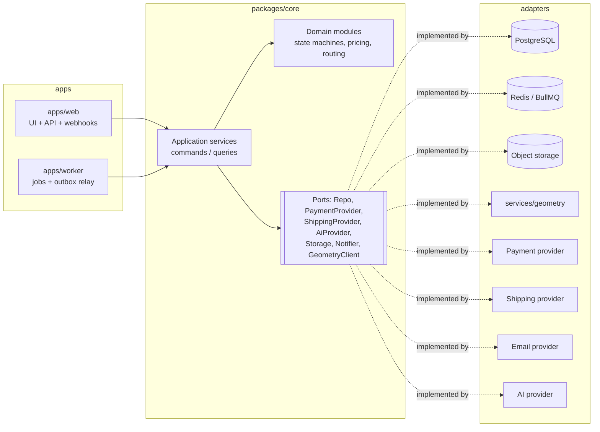
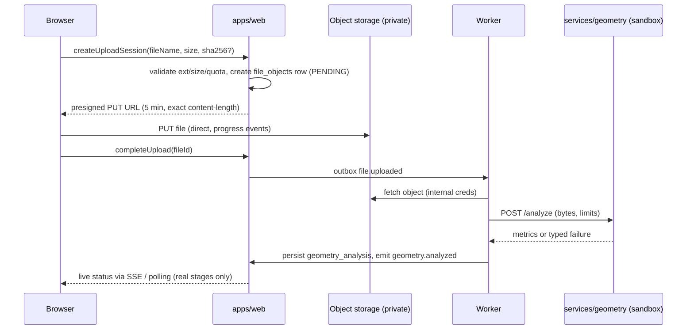

# Technical Architecture

> Status: **Draft v0.1 — awaiting owner approval** · Phase 0A
> Related: [DATABASE](./DATABASE.md) · [SECURITY](./SECURITY.md) · [DECISIONS](./DECISIONS/README.md)

## 1. Architectural style

A **modular monolith** (ADR-0002) made of a small number of deployables:

| Deployable | Tech | Responsibility |
|---|---|---|
| `apps/web` | Next.js 16 (App Router), React 19, TypeScript | All three UI surfaces (customer, supplier, admin), the HTTP API (route handlers / server actions) and webhooks |
| `apps/worker` | Node.js 20+ TypeScript, BullMQ | Background jobs, outbox relay, schedulers (quote expiry, SLA timers, payout cycles), provider polling |
| `services/geometry` | Python 3.12, FastAPI | Parses untrusted mesh files and produces geometry metrics. It runs sandboxed with no outbound network |
| PostgreSQL 16 | — | System of record |
| Redis 7 | — | Job queues, rate limiting, short-lived cache. **Never** a system of record |
| S3-compatible storage | MinIO (local) / S3-compatible (prod) | Private object storage for CAD files, photos and labels |

No microservices. No Kubernetes in the MVP. Python is used only where the geometry/scientific tooling clearly benefits (mesh analysis now, computer vision later).

### Deviation from the suggested repository structure

The specification suggested `/apps/customer-web`, `/apps/admin`, `/apps/supplier`, `/apps/api` and `/services/{ai,pricing,routing,notifications}`. This plan deliberately simplifies that (ADR-0002):

- **One Next.js app with three surfaces** instead of three apps plus an API app. The surfaces are separated by route group and host (`app.`, `partners.`, `ops.`), and each has its own layout, navigation, auth guard and cookie scope. Next.js already code-splits per route, so customer pages never load admin code. Domain logic lives in packages, so splitting into separate apps later is a mechanical change. Exit criterion: split `admin` into its own deployable if (a) the admin needs network-level isolation (VPN / IP allowlist) or (b) build times exceed 10 minutes.
- **Pricing, routing, notifications and AI are in-process modules**, not services. They have no independent scaling or language need. Only geometry is a separate process, because it needs Python *and* sandboxing of untrusted input.

## 2. Repository layout (target, greenfield — see ADR-0001)

```
/apps
  /web                    Next.js — (customer) (supplier) (admin) route groups, /api, /webhooks
  /worker                 BullMQ workers, outbox relay, cron schedulers
/services
  /geometry               FastAPI mesh analysis (trimesh/numpy), sandboxed container
/packages
  /core                   Domain + application layer, one folder per bounded module (below)
  /db                     Drizzle schema, migrations (SQL), seed, test fixtures
  /tokens                 Design tokens (source of truth) → CSS variables, TS constants
  /ui                     React design-system components (built on headless primitives)
  /motion                 Motion tokens, React motion primitives, reduced-motion handling
  /i18n                   Locale config, message catalogs (he/en/ru), formatters, RTL helpers
  /auth                   Session, RBAC policy engine, permission catalog
  /validation             Shared zod schemas (API contracts, AI output schemas)
  /logging                Structured logger (pino), request context, redaction
  /config                 Typed env loading (zod), feature-flag client
  /types                  Cross-cutting branded types (Id<T>, Money, Locale…)
  /testing                Test factories, fake providers, Playwright helpers
/infrastructure
  /docker                 docker-compose.yml, Dockerfiles
  /terraform              (Phase 5) production infrastructure
/docs                     This planning package, ADRs
/tests
  /e2e                    Playwright, three-language matrix
  /load                   (Phase 9) k6 scripts
```

Tooling: **pnpm workspaces + Turborepo** (ADR-0003), TypeScript `strict`, ESLint + Prettier, **dependency-cruiser** to enforce module boundaries, Vitest, Playwright.

## 3. Module (bounded context) map — `packages/core/src/modules/*`

Each module exposes **only** `index.ts` (public commands, queries, events and types). Cross-module imports of internals fail CI.

| Module | Owns | Key aggregates | Publishes events |
|---|---|---|---|
| `identity` | Users, sessions, roles, role assignments | User, RoleAssignment | `user.registered` |
| `organizations` | Customer orgs (B2B), supplier orgs, membership | Organization, Membership | `org.member_added` |
| `catalog` | Manufacturing processes, materials, finishes, colors, capability matrix | Process, Material, MaterialVariant | `catalog.material_changed` |
| `files` | Upload sessions, file objects, scanning status, signed-URL issuance | FileObject | `file.uploaded`, `file.scanned` |
| `geometry` | Geometry analysis requests/results (client of `services/geometry`) | GeometryAnalysis | `geometry.analyzed`, `geometry.failed` |
| `requirements` | Usage answers → technical requirements, manufacturability rules | RequirementSet | `requirements.completed` |
| `orders` | Wizard drafts, orders, line items, the order state machine | Order, OrderItem | `order.*` transitions |
| `pricing` | Pricing rule sets (versioned), the price calculation engine | PricingRuleSet | — (pure) |
| `quotes` | Quotes, immutable price snapshots, expiry, manual overrides | Quote | `quote.ready`, `quote.expired`, `quote.accepted` |
| `suppliers` | Supplier profiles, locations, machines, capabilities, capacity, performance stats | Supplier, Machine | `supplier.activated` |
| `routing` | Candidate filtering, scoring, assignment, offers, overrides, explanations | RoutingDecision, JobOffer | `routing.assigned`, `routing.failed` |
| `production` | Production jobs and their state machine | ProductionJob | `job.accepted`, `job.started`, `job.completed` |
| `qc` | Inspections, measurements, defects, verdicts, reprint requests, root cause | Inspection | `qc.passed`, `qc.failed` |
| `payments` | Payment intents, transactions, refunds, the PaymentProvider port | Payment, Refund | `payment.succeeded`, `refund.completed` |
| `payouts` | Supplier payout ledger, statements | PayoutStatement | `payout.issued` |
| `shipping` | Shipments, tracking, labels, the ShippingProvider port | Shipment | `shipment.created`, `shipment.delivered` |
| `notifications` | Templates (per locale), channel routing, delivery log, preferences | Notification | — |
| `design` | Design requests, revisions, approvals (DESIGN_REQUIRED workflow) | DesignRequest, DesignRevision | `design.submitted`, `design.approved` |
| `parts` | Digital Part Library (Phase 7) | DigitalPart, PartRevision | `part.published` |
| `ai` | AI runs, prompt registry, schema validation, the provider port (Phase 6) | AiRun | `ai.run_completed` |
| `support` | Tickets, disputes, escalations | Ticket, Dispute | `dispute.opened` |
| `audit` | Append-only audit events | AuditEvent | — |
| `analytics` | Product analytics event capture and KPI projections | — | — |
| `flags` | Feature flags (DB-backed, cached) | FeatureFlag | — |

**Dependency direction:** `apps → core application services → core domain → (ports)`. Adapters (DB repositories, providers) implement ports and are wired in a composition root per app. The domain layer imports nothing from Next.js, Drizzle or provider SDKs.



## 4. Request and command flow

1. **UI** (Server Component or Client Component) calls a **server action** or **route handler**. Both are thin. They (a) authenticate, (b) parse input with zod, (c) call one application command or query, and (d) map the result to a view model or a localized error key.
2. The **application command** loads aggregates, checks **authorization** (`can(actor, action, resource)`), invokes domain logic, and persists **in one DB transaction** together with: audit event rows, domain event rows in the **outbox**, and analytics events.
3. The **outbox relay** (worker) publishes outbox rows to BullMQ queues. **Handlers are idempotent** (keyed by event id) and react, e.g. `quote.ready → send notification`.
4. Errors are typed `DomainError(code)` values. The UI maps `code` → a translated message. Raw backend errors never reach the user.

**Idempotency:** all mutating API endpoints accept an `Idempotency-Key`. Server actions get an automatic key per form submission. Webhooks are de-duplicated by provider event id (`inbound_webhooks` unique constraint).

## 5. State machines

Implemented as **pure transition tables** in the domain: `(state, event) → next state + guards + required permission + side-effect events`. A generic `transition()` helper enforces validity, permission, timestamps and the audit event. Detail is in [DATABASE §5](./DATABASE.md#5-state-machines) and ADR-0009.

The spec's single order state list is kept as the **customer-facing Order status**. It is backed by separate sub-machines so that one aggregate doesn't have to model every concern:

- **Order** (commercial lifecycle) — the spec states plus `QUOTE_EXPIRED` handling on the Quote, and an orthogonal `on_hold` flag (not a state) for "blocked by ops".
- **Quote** — `DRAFT → READY → ACCEPTED | EXPIRED | SUPERSEDED | WITHDRAWN`
- **DesignRequest** — `REQUESTED → IN_PROGRESS → SUBMITTED → CHANGES_REQUESTED → APPROVED | CANCELLED`
- **ProductionJob** — `OFFERED → ACCEPTED | DECLINED | EXPIRED → IN_PRODUCTION → PRODUCED → QC_PENDING → QC_PASSED | QC_FAILED → (REPRINT → IN_PRODUCTION) → HANDED_OFF`
- **Payment** — `PENDING → AUTHORIZED → CAPTURED → PARTIALLY_REFUNDED | REFUNDED | FAILED | CANCELLED`
- **Shipment** — `DRAFT → LABEL_CREATED → PICKED_UP → IN_TRANSIT → OUT_FOR_DELIVERY → DELIVERED | EXCEPTION | RETURNED`

Order status advances in response to sub-machine events (e.g. `job.accepted → SUPPLIER_ACCEPTED`). MVP constraint: **one production job per order item, and all items of an order go to one supplier.** Split fulfilment is deferred (data model ready: jobs reference order items).

## 6. Surfaces, routing and hosts

| Surface | Host (prod) | Route group | Auth | Design density |
|---|---|---|---|---|
| Customer + marketing | `www.` / `app.` | `(customer)` | Optional until checkout (guest draft → claim on sign-in) | Spacious |
| Supplier | `partners.` | `(supplier)` | Required, supplier roles | Large touch targets |
| Admin / ops | `ops.` | `(admin)` | Required, staff roles + MFA | Dense |

Locale is the first path segment: `/{he|en|ru}/…` (ADR-0007). A request proxy (Next 16 renamed `middleware` to **`proxy`**; verify against `node_modules/next/dist/docs` before implementing, per AGENTS.md) resolves host → surface and locale → redirect, and attaches `request_id`.

## 7. Files and geometry pipeline



The geometry service validates magic bytes, enforces size/triangle/time limits (and zip-bomb limits for 3MF), and returns: bounding box (mm), volume, surface area, triangle count, watertightness, non-manifold edges, inverted normals, disconnected shells, thin-wall estimate, overhang area estimate, and a simplified preview mesh (glb) for the viewer. Unit detection: STL has no units, so a heuristic suggests mm vs inch and **the customer confirms**. STEP is deferred (spike M1-T09).

Print-time estimation for the MVP is a **calibrated heuristic** (volume, bounding box, material, and a quality profile → minutes) whose coefficients live in the pricing rule set. Slicer-CLI estimation (e.g. PrusaSlicer/OrcaSlicer CLI) is a Phase 3–4 improvement that needs a licence review (AGPL) and runs isolated in the geometry service.

## 8. Pricing, quotes and routing (summary — detailed in MASTER_PLAN §13–§15; dedicated `PRICING.md` / `ROUTING.md` docs are created in M2 / M3)

- **Pricing engine:** a pure function `price(input, ruleSet) → PriceBreakdown`. Integer minor units, banker's rounding only at line totals, and an explicit rounding rule per currency. Cost-plus, with optional manual/value-based override (an override requires a reason and a permission, and is audited).
- **Quote snapshot:** stores inputs, ruleSet id+version, every line, the expected payout, the margin, tax, currency and expiry. **It is never recomputed from current rules.**
- **Routing:** deterministic filter (hard constraints) → weighted score (configurable weights per rule-set version) → capacity check → offer with timeout → fallback to the next candidate → escalate to manual. The explanation (every candidate, score components, and why each was excluded) is stored.

## 9. Provider abstraction (ADR-0011)

Every external dependency is a **port** (TypeScript interface in `core`) with:
1. a **fake adapter** (deterministic, used in tests, local dev and E2E),
2. one or more **real adapters** in `packages/core/src/adapters/<provider>`, written only from official documentation,
3. typed config in `packages/config`, documented in `.env.example`,
4. contract tests that run against the fake *and* (nightly, with sandbox credentials) the real adapter.

| Port | Methods | MVP adapter (candidates — choose in milestone spike) |
|---|---|---|
| `PaymentProvider` | `createPayment` `confirmPayment` `refundPayment` `getPaymentStatus` `handleWebhook` | Israeli PSP with hosted payment page + tokenization (candidates: CardCom, Tranzila, PayPlus, Grow). Card data never touches our servers |
| `ShippingProvider` | `getQuote` `createShipment` `cancelShipment` `trackShipment` `getLabel` | Israeli courier with an API (candidates evaluated in M5) + `ManualShippingProvider` (admin enters tracking) |
| `InvoiceProvider` | `issueInvoice` `issueCreditNote` `getDocument` | Certified Israeli invoicing service (candidates evaluated in M5) |
| `StorageProvider` | `presignPut` `presignGet` `head` `delete` `copy` | S3 API (MinIO locally) |
| `EmailProvider` | `send(templateId, locale, to, vars)` | Transactional email service with an EU/IL region |
| `SmsProvider` / `WhatsAppProvider` | `send` | Phase 5+ / later |
| `AiProvider` | `generateStructured(promptRef, input, schema)` | Phase 6; model/provider selected by evaluation |
| `GeometryClient` | `analyze(fileRef, options)` | `services/geometry` |
| `AnalyticsSink` | `track(event)` | First-party Postgres table; optional external sink later |

## 10. Background jobs and scheduling (ADR-0005)

- **Transactional outbox** in Postgres → relay → BullMQ queues on Redis. This means there are no lost or phantom events, because DB state and event creation commit together.
- Queues: `geometry`, `notifications`, `routing`, `payments-reconcile`, `shipping-sync`, `ai` (Phase 6), `maintenance`.
- Every job has retries with exponential backoff, a dead-letter queue, idempotency keys and a max attempts limit. Failures surface in the admin "System Events" view (manual retry button).
- Schedulers: quote expiry, offer timeouts (SLA), stale-draft reminders, shipping tracking sync, payment reconciliation, payout cycle, data-retention purges.

## 11. Observability

- **Logs:** pino JSON. Every line carries `request_id`, `user_id`, `org_id`, `order_id`, `job_id` and `supplier_id` where known (AsyncLocalStorage context). PII/secret redaction allow-list.
- **Errors:** an error-monitoring SDK (Sentry-compatible) in web, worker and geometry, with source maps uploaded and PII scrubbing.
- **Tracing / metrics:** OpenTelemetry SDK wired from M0F (no-op exporter locally, OTLP in prod). Key metrics: request latency, queue depth/age, job failure rate, geometry duration, quote calculation latency, webhook failures.
- **Health:** `/healthz` (liveness), `/readyz` (DB, Redis, storage, geometry).
- **Business signals:** admin "needs attention" is computed from domain state, not logs.

## 12. Frontend architecture

- **Server Components by default.** Client components only for interactivity (wizard steps, viewer, upload, tables).
- **Data:** server-side reads via application queries. Client mutations via server actions. TanStack Query only where live client caching is needed (admin tables, status polling).
- **Forms:** React Hook Form + zod (the shared schema from `packages/validation`) with localized messages.
- **Styling:** Tailwind CSS v4 driven by CSS variables from `packages/tokens`. Logical properties only (`ms-*`, `pe-*`, `start-*`); a lint rule bans physical `ml/mr/pl/pr/left/right` utilities.
- **Components:** `packages/ui`, built on headless accessible primitives (Base UI), with a token-bound visual layer. A workbench (Storybook) shows each component in he/en/ru, light/dark and reduced motion.
- **3D viewer:** three.js via @react-three/fiber + drei, **dynamically imported** only on routes that need it, with a static preview image first (ADR-0015).
- **Motion:** CSS transitions for micro-interactions. The Motion library (motion.dev) for orchestrated, layout and stateful sequences. All of it is driven by `packages/motion` tokens (ADR-0014).

## 13. Environments and deployment (summary — `DEPLOYMENT.md` is written in M5)

| Env | Purpose | Data |
|---|---|---|
| `local` | Docker Compose: Postgres, Redis, MinIO, Mailpit, geometry | Seeded fakes |
| `ci` | Ephemeral services in GitHub Actions | Fixtures |
| `preview` | Per-PR deploy of `apps/web` (optional, Phase 0F+) | Synthetic seed |
| `staging` | Production-like, sandbox providers | Synthetic + anonymized |
| `production` | — | Real |

Production hosting is proposed in ADR-0016: managed containers, managed Postgres with PITR, managed Redis and S3-compatible storage, in a region chosen for latency to Israel and for compliance (candidates: AWS `il-central-1` or an EU region). IaC with Terraform. Zero-downtime deploys, and migrations that follow expand/contract.

## 14. Performance budgets

| Item | Budget |
|---|---|
| Customer route initial JS (gzip) | ≤ 170 KB (excluding the lazily loaded 3D viewer chunk) |
| 3D viewer chunk | ≤ 250 KB gzip, loaded on interaction/visibility only |
| LCP (p75, 4G mobile) | ≤ 2.5 s |
| INP (p75) | ≤ 200 ms |
| CLS | ≤ 0.1 |
| API p95 (read / write) | ≤ 300 ms / ≤ 600 ms |
| Quote calculation | ≤ 50 ms (pure) |
| Geometry analysis (≤ 50 MB STL) | p95 ≤ 20 s |
| Viewer frame rate | ≥ 50 fps on a mid-range phone for preview meshes ≤ 200k triangles (decimated server-side) |
