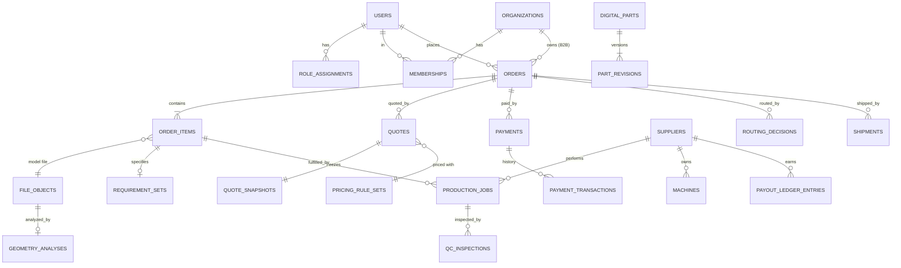

# Database Design

> Status: **Draft v0.1 — awaiting owner approval** · Phase 0A
> Engine: PostgreSQL 16 · Access: Drizzle ORM + reviewed SQL migrations (ADR-0004)

## 1. Conventions

| Topic | Rule |
|---|---|
| Primary keys | `uuid` (UUIDv7, time-ordered), generated in the app. Human-facing references are separate: `order_number` like `MF-24-000123`, unique, never reused |
| Timestamps | `timestamptz`, UTC. Every table has `created_at` and `updated_at`; state-bearing tables also keep `<state>_at` columns or a transition history table |
| Money | `bigint` **minor units** + `currency char(3)` on the same row. No floats, ever. A `Money` value object in code |
| Quantities / dimensions | `numeric(12,3)` mm, `numeric(14,3)` mm³; grams `numeric(10,2)`; minutes `integer` |
| Enums | Postgres `text` + `CHECK` constraint (easier migrations than native enums), mirrored by TS literal unions generated from one source |
| Multi-tenancy | `customer_org_id` / `supplier_id` scoping columns. Authorization is enforced in the application layer (RBAC + scope). Row-Level Security is added as defense in depth on the tables that hold customer files and orders (M0F decision task M0F-T07) |
| Soft delete | Avoided. Use explicit status (`archived`, `deactivated`). Privacy deletion = anonymization job (see SECURITY §9) |
| Immutability | `quote_snapshots`, `audit_events`, `payment_transactions`, `payout_ledger_entries`, `ai_runs`, `part_revisions` are **insert-only**. Enforced by a trigger that rejects UPDATE/DELETE, plus DB grants |
| Versioning | Rules (`pricing_rule_sets`, `routing_rule_sets`) are versioned rows; `status in (draft, active, retired)`; exactly one active per scope (partial unique index) |
| JSON | `jsonb` only for genuinely schemaless data (provider payloads, AI outputs, geometry extras), always validated by a zod schema with a `schema_version` |
| Localized content | Admin-managed catalog text (material names, descriptions) in `*_translations(entity_id, locale, field, value)`; UI strings stay in message catalogs |
| Migrations | Forward-only, reviewed SQL, expand → migrate → contract for breaking changes; every migration runs in CI against a fresh DB and against the previous release's schema |
| Indexes | Every FK indexed; partial indexes for "needs attention" queues; review `EXPLAIN` for each admin list query |

## 2. Entity overview (by module)

### identity / organizations
- `users` (id, email citext unique, phone, display_name, preferred_locale, marketing_consent_at, terms_accepted_version, status, mfa_enabled)
- `auth_*` tables per the chosen auth library (ADR-0010): sessions, accounts, verification tokens
- `organizations` (id, kind `customer|supplier|platform`, name, legal_name, tax_id, country, default_locale, default_currency, billing_mode `card|invoice` [Phase 8])
- `memberships` (user_id, organization_id, status)
- `role_assignments` (user_id, role, scope_type `platform|organization|supplier`, scope_id, granted_by, granted_at, revoked_at)
- `org_branches`, `cost_centers`, `approval_policies` *(Phase 8)*

### catalog
- `processes` (code `FDM|SLA|SLS|CNC|LASER|SHEET_METAL|METAL_AM`, status, capability_schema jsonb). Only FDM is `active` in the MVP
- `materials` (code e.g. `PLA`, `PETG`, `ABS`, `ASA`, `TPU_95A`, `PA_CF`; process_code; properties: max_service_temp_c, uv_resistance, flexibility, strength_index, food_contact_certifiable, density_g_cm3; status)
- `material_variants` (material_id, color, finish, supplier-independent SKU)
- `material_translations`
- `quality_profiles` (code `draft|standard|fine`, process_code; internal parameters: layer_height, walls, infill — **hidden from customers** unless advanced mode)

### files / geometry
- `upload_sessions` (id, owner, expected_size, expected_type, expires_at, status)
- `file_objects` (id, owner_user_id, owner_org_id, storage_key, original_name, mime_detected, ext, size_bytes, sha256, kind `model|photo|drawing|production|label|qc_photo|design_revision`, scan_status `pending|clean|rejected`, retention_class)
- `geometry_analyses` (file_id, status `queued|running|succeeded|failed`, failure_code, units_detected, units_confirmed, bbox_x/y/z_mm, volume_mm3, surface_area_mm2, triangle_count, shells, is_watertight, non_manifold_edges, min_wall_mm_estimate, overhang_area_mm2, preview_file_id, analyzer_version, duration_ms)

### requirements / orders
- `wizard_drafts` (id, owner_user_id nullable, anonymous_token_hash, flow `file|object|idea`, step, payload jsonb versioned, expires_at). Server-persisted draft, so progress survives refresh and device changes after sign-in
- `requirement_sets` (order_item_id, source `customer|ai|staff`, usage answers jsonb, derived technical requirements jsonb, assumptions jsonb, version, approved_by)
- `orders` (id, order_number, customer_user_id, customer_org_id, flow, status, on_hold bool, hold_reason, urgency_tier, currency, locale_at_order, ship_to_address_id, current_quote_id, assigned_supplier_id, promised_ship_date, promised_delivery_date, all `<status>_at` timestamps)
- `order_items` (id, order_id, file_id, digital_part_revision_id, title, quantity, material_variant_id, process_code, quality_profile_code, requirement_set_id, status)
- `order_status_history` (order_id, from, to, event, actor_id, actor_type `user|system|ai`, reason, at). **Insert-only**
- `addresses` (owner, recipient, phone, line1, line2, city, postal_code, country, notes)

### pricing / quotes
- `pricing_rule_sets` (id, version, scope, status, effective_from, rules jsonb validated by schema: machine_rate_per_hour, material_cost_per_gram, setup_fee, labor_minutes, post_processing, failure_allowance_pct, packaging, margin targets, urgency multipliers, quantity breaks, minimum order value, tax rule refs, rounding rule)
- `payout_rate_cards` (supplier_id nullable = default, process, material, rate structure, version)
- `tax_rates` (country, kind, rate_bps, effective_from, effective_to). **VAT is data, not code**
- `quotes` (id, order_id, status, expires_at, ruleset_id, created_by `system|staff`, override_reason, superseded_by)
- `quote_snapshots` (quote_id unique, inputs jsonb, lines jsonb, subtotal_minor, tax_minor, total_minor, expected_payout_minor, expected_margin_minor, currency, engine_version, hash). **Insert-only**
- `quote_lines` (quote_id, kind `manufacturing|material|setup|post_processing|urgency|design_fee|shipping|discount|service_fee|tax`, label_key, amount_minor, meta)

### suppliers / routing / production / qc
- `suppliers` (organization_id, status `invited|onboarding|active|paused|suspended`, tier, service_regions, lead_time_days_default, minimum_job_minor, working_hours jsonb, quality_score, on_time_rate, acceptance_rate, cancellation_rate, reprint_rate — **stats are projections recomputed by a job**, with the source events kept)
- `supplier_locations` (supplier_id, address, geo point, pickup_hours)
- `machines` (supplier_id, process_code, model, build_volume_x/y/z_mm, nozzle_options, status, daily_capacity_minutes)
- `machine_materials` (machine_id, material_variant_id)
- `supplier_certifications` (supplier_id, kind, valid_until, document_file_id)
- `supplier_capacity_reservations` (supplier_id, date, minutes_reserved)
- `routing_rule_sets` (version, weights jsonb, hard_constraints jsonb, offer_timeout_minutes, max_attempts, status)
- `routing_decisions` (order_id, ruleset_version, candidates jsonb [supplier, score components, excluded_reason], chosen_supplier_id, mode `auto|manual_confirmed|manual_override`, actor_id, reason). **Insert-only**
- `job_offers` (production_job_id, supplier_id, status `pending|accepted|declined|expired|withdrawn`, expires_at, decline_reason)
- `production_jobs` (id, order_item_id, supplier_id, status, payout_snapshot_minor, due_at, started_at, produced_at, attempt_no, production_file_id)
- `qc_inspections` (production_job_id, stage `supplier_self_check|platform_review|customer_report`, reviewer_id, verdict `pass|fail|needs_info`, measurements jsonb, checklist jsonb, notes)
- `qc_photos` (inspection_id, file_id)
- `qc_defects` (inspection_id, code `warping|layer_shift|stringing|under_extrusion|dimension_out_of_tolerance|surface|color|missing_feature|other`, severity, description)
- `reprint_requests` (production_job_id, reason_code, root_cause, corrective_action, cost_bearer `supplier|platform|customer`, new_job_id)

### payments / payouts / shipping / invoicing
- `payments` (id, order_id, provider, provider_ref, status, amount_minor, currency, idempotency_key unique)
- `payment_transactions` (payment_id, kind `authorize|capture|refund|void|chargeback`, amount_minor, provider_event_id, raw_ref, at). **Insert-only**
- `refunds` (payment_id, amount_minor, reason_code, requested_by, approved_by, status)
- `invoices` (order_id, provider, document_number, kind `tax_invoice_receipt|credit_note`, file_id, allocation_number nullable)
- `payout_ledger_entries` (supplier_id, production_job_id, kind `earning|adjustment|clawback|payment`, amount_minor, currency, statement_id). **Insert-only, double-entry style balance per supplier**
- `payout_statements` (supplier_id, period, total_minor, status `open|closed|paid`, supplier_invoice_file_id)
- `shipments` (order_id, provider, service_level, status, tracking_number, label_file_id, from_location_id, to_address_id, cost_minor, price_minor)
- `shipment_events` (shipment_id, status, provider_event_id unique, at, raw)

### design / parts / ai
- `design_requests`, `design_revisions` (files, notes, designer_id), `design_approvals` (customer decision, at, comment)
- `digital_parts` (id, internal_code, title, description, category, compatibility jsonb {manufacturer, model, year_from, year_to}, visibility `private|organization|public`, owner_org_id, designer_id, status, search_tsv, sales_count, failure_rate, rating_avg) *(Phase 7)*
- `part_revisions` (part_id, revision_no, cad_file_id, production_file_id, preview_file_ids, dimensions, allowed_materials, production_profile jsonb, approved_by, approved_at, changelog). **Insert-only**. An approved revision is never edited; changes create a new revision
- `ai_runs` (id, purpose `intake|engineering|pricing_context|routing_context|support`, provider, model, prompt_id, prompt_version, input_ref, output jsonb, schema_version, validation_status, confidence, latency_ms, token_usage, cost_minor, created_at) *(Phase 6)*
- `ai_run_reviews` (ai_run_id, reviewer_id, edits jsonb diff, final_output jsonb, decision)

### platform
- `audit_events` (id, at, actor_id, actor_type, action, resource_type, resource_id, org_scope, before jsonb, after jsonb (redacted), request_id, ip_hash). **Insert-only, partitioned monthly**
- `outbox_events` (id, type, payload, created_at, published_at, attempts)
- `inbound_webhooks` (provider, provider_event_id, signature_valid, received_at, processed_at, status). **Unique (provider, provider_event_id)**
- `idempotency_keys` (key, actor, request_hash, response, expires_at)
- `feature_flags` (key, enabled, rollout jsonb {roles, orgs, percentage}, updated_by)
- `notifications`, `notification_deliveries`, `notification_preferences`
- `analytics_events` (name, at, session_id, user_id, org_id, props jsonb, locale, surface) — partitioned
- `tickets`, `disputes`, `dispute_events`
- `consents` (user_id, purpose `marketing|analytics`, granted, at, source) — separate from operational processing
- `system_settings` (key, value jsonb, updated_by)

## 3. Key invariants (enforced in the domain *and*, where possible, by constraints)

1. An order can be paid only against a quote that is `READY`, unexpired, and belongs to that order. The paid amount equals `quote_snapshots.total_minor`.
2. A quote snapshot is immutable. A historical quote is never recomputed.
3. Exactly one `ACCEPTED` job offer per production job attempt.
4. A production job's `payout_snapshot_minor` is frozen at acceptance.
5. Refunds total ≤ captured amount (check per payment in the transaction).
6. An approved part revision is immutable. A new approval requires a new revision.
7. Every status change writes `*_status_history` + `audit_events` + `outbox_events` in the same transaction.
8. File access: a supplier can read a production file only while it has an active (accepted, not handed off) job referencing it.

## 4. Query hot paths and indexes (initial)

| Query | Index |
|---|---|
| Admin "needs attention" | partial `orders(status, updated_at) WHERE on_hold OR status IN ('REVIEW_REQUIRED','QC_FAILED','DISPUTED',…)` |
| Late orders | `orders(promised_ship_date) WHERE status NOT IN terminal` |
| Supplier job inbox | `production_jobs(supplier_id, status, due_at)` |
| Pending offers | `job_offers(supplier_id, status, expires_at) WHERE status='pending'` |
| Customer order list | `orders(customer_user_id, created_at desc)` |
| Webhook dedup | unique `inbound_webhooks(provider, provider_event_id)` |
| Outbox relay | partial `outbox_events(created_at) WHERE published_at IS NULL` |
| Part search (Phase 7) | GIN `digital_parts(search_tsv)`; trigram on `internal_code` |

## 5. State machines

### 5.1 Order (customer-facing lifecycle)

| From | Event | To | Who may trigger | Guards / notes |
|---|---|---|---|---|
| — | `create` | DRAFT | customer, staff | — |
| DRAFT | `submit_requirements` | REQUIREMENTS_PENDING | customer | wizard complete |
| REQUIREMENTS_PENDING | `auto_quote_ok` | QUOTE_READY | system | file flow, all rules pass, `AUTO_PRICING` on |
| REQUIREMENTS_PENDING | `needs_review` | REVIEW_REQUIRED | system | rule flagged / Flow B,C / restricted use |
| REVIEW_REQUIRED | `requires_design` | DESIGN_REQUIRED | staff (ops, designer) | — |
| REVIEW_REQUIRED | `publish_quote` | QUOTE_READY | staff (ops) | quote exists |
| DESIGN_REQUIRED | `design_started` | DESIGN_IN_PROGRESS | designer | design fee paid *or* waived with permission |
| DESIGN_IN_PROGRESS | `design_submitted` | DESIGN_APPROVAL | designer | revision attached |
| DESIGN_APPROVAL | `design_changes_requested` | DESIGN_IN_PROGRESS | customer | revision limit per policy |
| DESIGN_APPROVAL | `design_approved` | QUOTE_READY | customer | production quote created |
| QUOTE_READY | `quote_expired` | REQUIREMENTS_PENDING | system | re-quote with current rules (new quote, old snapshot kept) |
| QUOTE_READY | `checkout_started` | PAYMENT_PENDING | customer | quote valid |
| PAYMENT_PENDING | `payment_failed` / `abandoned` | QUOTE_READY | system | — |
| PAYMENT_PENDING | `payment_succeeded` | PAID | system (webhook) | amount = snapshot total |
| PAID | `routing_started` | ROUTING | system | — |
| ROUTING | `supplier_assigned` | SUPPLIER_ASSIGNED | system / ops | offer sent |
| ROUTING | `routing_failed` | ROUTING + `on_hold` | system | escalate to ops |
| SUPPLIER_ASSIGNED | `offer_declined` / `offer_expired` | ROUTING | system | next candidate |
| SUPPLIER_ASSIGNED | `supplier_accepted` | SUPPLIER_ACCEPTED | supplier operator/manager | — |
| SUPPLIER_ACCEPTED | `production_started` | PRODUCTION | supplier | — |
| PRODUCTION | `production_completed` | QC_PENDING | supplier | QC photos + measurements uploaded |
| QC_PENDING | `qc_passed` | READY_FOR_SHIPMENT | quality reviewer (or `AUTOMATED_QC` later) | — |
| QC_PENDING | `qc_failed` | QC_FAILED | quality reviewer | defect recorded |
| QC_FAILED | `reprint_ordered` | REPRINT_REQUIRED | quality reviewer / ops | reprint request with reason |
| QC_FAILED | `accepted_with_concession` | READY_FOR_SHIPMENT | ops + customer consent | logged |
| REPRINT_REQUIRED | `reprint_started` | PRODUCTION | supplier (same or re-routed) | new job attempt |
| READY_FOR_SHIPMENT | `shipment_created` | SHIPPED | ops / system | label + tracking |
| SHIPPED | `delivered` | DELIVERED | system (tracking) / ops | — |
| DELIVERED | `completion_window_elapsed` / `customer_confirmed` | COMPLETED | system / customer | window e.g. 7 days |
| any pre-PAID | `cancel` | CANCELLED | customer / ops | — |
| PAID…SUPPLIER_ACCEPTED | `cancel` | CANCELLED (+ refund) | ops (customer request) | refund flow |
| PRODUCTION…DELIVERED | `dispute_opened` | DISPUTED | customer / support | within the 7-day delivery window; COMPLETED is terminal |
| DISPUTED | `dispute_resolved_*` | REFUNDED / COMPLETED / REPRINT_REQUIRED | ops / finance | — |
| CANCELLED (paid) / DISPUTED | `refund_completed` | REFUNDED | system | full refund; partial refunds don't change status |

Terminal: `COMPLETED`, `CANCELLED` (unpaid), `REFUNDED`. `on_hold` can be set and cleared by ops in any non-terminal state (with a reason); while it is set, it blocks system-triggered transitions.

### 5.2 Sub-machines

See [ARCHITECTURE §5](./ARCHITECTURE.md#5-state-machines). Each has its own transition table in `packages/core/src/modules/<module>/state-machine.ts`, with exhaustive unit tests: every (state, event) pair is asserted as valid or invalid.

## 6. Seed data (local / staging)

Processes (FDM active, others inactive), the six base materials with colors, three quality profiles, an initial pricing rule set v1 (**all values are placeholders, to be set by the business**), routing rule set v1, two fake suppliers with machines, one user per role, sample STL fixtures (a valid cube, a non-manifold mesh, an oversized part, an inch-scaled part, a broken file).

## 7. Retention (initial proposal — confirm with legal)

| Data | Retention |
|---|---|
| Orders, invoices, payments, payouts | ≥ 7 years (tax) |
| Customer model files for orders | Life of account + reorder window; customer can delete (unless legally held) |
| Abandoned upload / draft files | 30 days |
| QC photos | 2 years |
| Audit events | 7 years (cold storage after 1 year) |
| Analytics events | 25 months, then aggregated |
| AI runs (inputs/outputs) | 1 year, then redacted metadata only |
| Logs | 30 days hot, 1 year archive (no PII payloads) |

## 8. Implementation deviations (M0R–M5)

The schema in `packages/db` follows this document except where noted. Each deviation keeps the
invariant it replaces; revisit when the listed trigger occurs.

| Planned | Implemented | Why | Revisit when |
|---|---|---|---|
| `material_translations`, `*_translations` tables | `i18n` JSONB column (`{ he, en, ru }: { name, description? }`) on `materials` and `material_variants` | Three locales, admin-managed, always read with the row; avoids a join on every catalog read | A fourth locale, or translation workflow tooling |
| `requirement_sets` table (versioned, per item) | `order_items.usage` (answers) + `order_items.requirements` (derived) JSONB; review reasons on `orders.review_reasons` | One requirement version per item in the MVP; the quote snapshot freezes what was priced | AI intake (M6) needs multiple versions/sources per item |
| Several production jobs per order (split fulfilment) | One active job per order; reprints create a new job with `attempt_no + 1`, the failed one is `CANCELLED` | AL-001: one supplier per order | Split orders (post-M5) |
| `order_status_history`, `audit_events`, `quote_snapshots`, `payment_transactions`, `routing_decisions` "append-only" | Enforced by database triggers that reject UPDATE/DELETE (migration `0001_platform_guards.sql`) | Stronger than application discipline | — |
| Payout ledger entries immutable | Insert-only, except a single NULL → value assignment of `statement_id` when a statement closes (trigger-guarded) | Statements group entries without rewriting amounts | — |
| `invoices` from a certified provider | `invoices` rows from the internal register with `invoice_number_seq` | No provider selected (KNOWN_ISSUES KI-016) | Provider chosen (D-4) |

Money stays integer minor units everywhere, and entity ids are UUIDv7.
