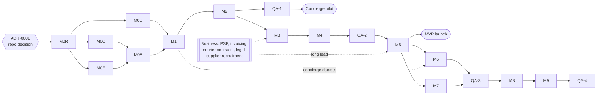

# Master Plan — Digital Manufacturing Platform

> Status: **Draft v0.1 — planning phase complete, awaiting owner approval. No production implementation has started.**
> Date: 2026-10-29 · Scope owner: Product / Architecture
> This is the single entry point. Each section summarizes and links to the detailed document.

| Document | Purpose |
|---|---|
| [PRODUCT](./PRODUCT.md) | Vision, business model, personas, MVP, KPIs, guardrails |
| [ARCHITECTURE](./ARCHITECTURE.md) | Modular monolith, modules, flows, providers, observability, budgets |
| [DATABASE](./DATABASE.md) | Conventions, entities, invariants, state machines, retention |
| [SECURITY](./SECURITY.md) | Threat model, authn/z, RBAC matrix, files, payments, privacy |
| [UX_ARCHITECTURE](./UX_ARCHITECTURE.md) | Personas, IA, wizard, journeys, workflow analysis, states |
| [UI_DESIGN_SYSTEM](./UI_DESIGN_SYSTEM.md) | Identity, tokens, components, status UI |
| [MOTION_SYSTEM](./MOTION_SYSTEM.md) | Motion tokens, informational animations, reduced motion |
| [LOCALIZATION_GLOSSARY](./LOCALIZATION_GLOSSARY.md) | i18n architecture, formatting, RTL, terminology |
| [QUALITY_PLAN](./QUALITY_PLAN.md) | Test strategy, matrix, DoD, audits, budgets |
| [RISK_REGISTER](./RISK_REGISTER.md) | Risks with mitigations |
| [ROADMAP](./ROADMAP.md) | Timeline, gates, dependency graph |
| [INITIAL_BACKLOG](./INITIAL_BACKLOG.md) | Fully specified tasks for the first implementation milestones |
| [KNOWN_ISSUES](./KNOWN_ISSUES.md) | Open issues, unknowns, inconsistencies awaiting decisions |
| [DECISIONS/](./DECISIONS/README.md) | Architecture Decision Records |

Documents still to be created in their milestones: `API.md` (M0F, extended every milestone), `PRICING.md` (M2), `ROUTING.md` (M3), `AI.md` (M6), `OPERATIONS.md` and `DEPLOYMENT.md` (M5).

---

## 1. Purpose and working method

We build in milestones following the mandatory protocol: READ → PLAN → IMPLEMENT → VERIFY → FULL TEST → UX REVIEW → UI REVIEW → MOTION REVIEW → SECURITY REVIEW → DOCUMENTATION → REPORT. After every 2–3 major milestones there's a quality audit (CRITICAL/HIGH fixed before continuing). See [QUALITY_PLAN §8](./QUALITY_PLAN.md#8-milestone-protocol-and-quality-audits).

## 2. Repository finding — read first

The current repository (`menatan2026-sketch/wacrm`) is a fork of **wacrm**, an MIT-licensed self-hostable **WhatsApp CRM** template (Next.js 16, React 19, Supabase, next-intl, Tailwind v4, shadcn/Base UI, Vitest, 36 SQL migrations). **None of its domain (inbox, broadcasts, pipelines, WhatsApp) is relevant to digital manufacturing.**

Recommendation (ADR-0001, *Proposed*): **build the Platform as a greenfield monorepo**, either a new repository or this repository after the CRM code is removed. Don't evolve the CRM. Reuse proven **patterns** (not code paths) from wacrm: security headers, the next-intl setup, API-key hashing, the SSRF guard on outbound webhooks, rate limiting, encrypted provider secrets, and the CI layout. This planning package lives in `/docs` of this repository for now and moves with the new codebase. **The owner must decide where the code lives before M0R starts** (KNOWN_ISSUES KI-001).

## 3. Complete product scope

Three customer entry flows (A file / B object / C idea) → requirements → recommendation → quote → checkout → routing to approved suppliers → production → QC → shipping → delivery → rating → reorder. Supporting capabilities: supplier network, pricing engine, routing engine, QC, payments, payouts, shipping, invoicing, notifications, AI assistance, Digital Part Library, B2B organizations, analytics, admin back office, audit, feature flags, manual fallback for every automation.

Manufacturing processes: **FDM only at first.** SLA, SLS, CNC, laser cutting, sheet metal and metal AM are supported by the abstraction (the `processes` catalog with a per-process capability schema, routing hard constraints per process, pricing rule sets per process, a per-process QC checklist template) but are not implemented. Adding a process = catalog data + a pricing model + capability fields + a QC template + a geometry check profile. There are no core code changes to the order flow.

## 4. Business model

The Platform is merchant of record: the customer pays the Platform, the supplier invoices the Platform, and the margin is the difference. All ten revenue streams are listed in [PRODUCT §4](./PRODUCT.md#4-business-model), along with the milestone that enables each one. The data model supports multiple revenue models via quote line kinds (`manufacturing`, `urgency`, `design_fee`, `shipping`, `service_fee`, `discount`) and plan entitlements (Phase 8).

Key business decisions are needed from the owner (§28): pricing parameters, margin targets, supplier payout model, cancellation policy, launch region, PSP/courier/invoicing vendors, legal entity.

## 5. MVP definition

**MVP** = milestones M0R → M5 complete. Flow A end-to-end with payment, FDM, approved suppliers, platform QC, Israeli shipping, three languages, mobile + desktop. Flows B and C are fully designed customer-side and fulfilled by humans (concierge). Full definition and success metrics are in [PRODUCT §8](./PRODUCT.md#8-mvp-definition).

**Concierge pilot** (recommended, flag `PILOT_MANUAL_PAYMENT`): after M2 (quotes working), run a limited pilot with invited customers. Payment is by a PSP payment link that ops sends manually, routing is manual by ops, and production/QC are tracked in the admin. This gives real demand, pricing and supplier data ~13 weeks before the full MVP, for little extra code.

## 6. UX architecture (summary)

Progressive disclosure, one primary action per screen, a "what happens next" panel everywhere, real state only, plain-language usage questions, and an advanced mode for experts. The wizard adapts per flow (corrected from the spec's fixed order: quantity/urgency move to the price step, and dimensions are *confirmed* for file uploads rather than entered). Full workflow analysis (the nine questions for 15 workflows), empty/loading/error taxonomy, cancellation/refund/reprint/escalation/manual-fallback flows: [UX_ARCHITECTURE](./UX_ARCHITECTURE.md).

## 7. Journeys

- **Customer:** Flow A ≤ 3 minutes to a price on mobile. Flows B/C submit in ≤ 5 minutes with an SLA-backed human response. Tracking shows a timeline and the next step, with proactive delay notices. Reorder in 2 taps. ([UX §5.1–5.2](./UX_ARCHITECTURE.md#5-journeys-summary-maps))
- **Supplier:** invite → 5-item onboarding → offer → accept → download → print → QC evidence → ready for pickup → payout statement. Designed for a phone on the production floor, with gloves. ([UX §5.3](./UX_ARCHITECTURE.md#53-supplier))
- **Admin:** an attention queue drives the day (blocked, late, failed, review-required, disputes, webhook failures). Every automated step has a manual action with a reason and an audit record. Dense tables, keyboard, command palette. ([UX §5.4](./UX_ARCHITECTURE.md#54-admin--ops))
- **B2B (Phase 8):** org library, approvals, POs, monthly invoicing.

## 8. UI design direction, design tokens and component strategy

- **Direction: "Precision, made visible."** Graphite instrument-like surfaces, hairline precision, mono measurements, coordinate-grid and layer-line motifs used purposefully, and one signature color (**Nozzle Amber**) reserved for *making* moments. Primary actions are **Calibration Blue**. Avoids generic SaaS, template marketplace and sci-fi HUD looks.
- **Tokens** (`packages/tokens`, OKLCH, light/dark): typography (IBM Plex Sans + Plex Sans Hebrew + Plex Mono, fluid display sizes, script-specific rules), a 4 px spacing scale (no arbitrary values), 6 breakpoints with 4/8/12-col grids, a 12-step neutral palette, semantic and domain status palettes (status = icon + label + color + tooltip), radii 4–16 px, 5 elevation levels with minimal shadow, borders including a dedicated *measurement* border.
- **Component strategy:** headless accessible primitives (Base UI) + our token-bound visual layer in `packages/ui`. Domain components (OrderCard, QuoteCard, JobCard, StatusTimeline, PriceBreakdown, MeasurementInput, ViewerFrame) are built on primitives. A Storybook workbench covers locale × direction × theme × reduced-motion, with visual regression + axe in CI. Business logic never lives in components.
- Detail: [UI_DESIGN_SYSTEM](./UI_DESIGN_SYSTEM.md).

## 9. Motion and animation strategy

Motion explains system state. Eight duration tokens (instant → educational, plus success and critical), 6 easings, 3 springs (overshoot ≤ 4 %), distance/opacity/scale tokens, and a logical inline axis that mirrors in RTL. Informational scenes: upload→analysis (bound to real geometry stage events), production timeline with layer buildup, admin routing explainer (actual stored scores), QC verdict, and the signature preview progression (original → analyzed → manufacturing preview → final). Reduced motion keeps all the information, and there's an in-app override. CSS for micro-interactions; Motion (motion.dev) lazily loaded for orchestration. Detail: [MOTION_SYSTEM](./MOTION_SYSTEM.md).

## 10. Multilingual and RTL/LTR strategy

next-intl with locale-prefixed routes (`/he`, `/en`, `/ru`). Detection: explicit choice > URL > Accept-Language > `he`, and the language never switches unexpectedly. 17 namespaces, semantic keys, a lint ban on literal strings and physical CSS properties, CI checks for catalog completeness and ICU argument parity, pseudo-locales for expansion/RTL testing, and `Intl`-based formatting for money/number/date/measurements (no manual currency symbols). RTL is first-class: logical CSS, bidi isolation for codes/measurements/file names, mirrored navigation/drawers/steppers/directional icons, non-mirrored viewer axes/charts/media. Hebrew copy is gender-neutral; Russian uses formal "вы". The glossary of 70+ domain terms needs native review. Detail: [LOCALIZATION_GLOSSARY](./LOCALIZATION_GLOSSARY.md).

## 11. Architecture boundaries

Modular monolith: `apps/web` (one Next.js app, three surfaces by route group + host), `apps/worker` (BullMQ + outbox relay + schedulers), `services/geometry` (sandboxed Python). PostgreSQL is the system of record, Redis handles queues/rate limits, and S3-compatible storage is private. 23 bounded modules in `packages/core` with public `index.ts` only, boundaries enforced by dependency-cruiser, and ports & adapters for every provider. This is a documented deviation from the suggested multi-app layout (ADR-0002). Detail: [ARCHITECTURE](./ARCHITECTURE.md).

## 12. Database model

PostgreSQL 16, Drizzle + reviewed SQL migrations, UUIDv7 ids, integer minor-unit money with currency, insert-only financial/audit/snapshot tables (trigger-enforced), versioned rule sets, an outbox, webhook dedup, and idempotency keys. ~70 tables across 17 modules. Order state machine (customer-facing) plus Quote, Design, ProductionJob, Payment and Shipment sub-machines. Full transition table with guards and roles: [DATABASE §5](./DATABASE.md#5-state-machines).

## 13. Pricing architecture

**Module:** `pricing` (pure engine) + `quotes` (snapshots). The dedicated `PRICING.md` is written in M2.

**Inputs:** geometry (volume, surface area, bbox, overhang area), material variant, quality profile, quantity, urgency tier, post-processing, destination (shipping), customer context (plan/discount), the active pricing rule set, the default payout rate card, and the tax rate.

**Calculation (cost-plus, all coefficients in the rule set, none hardcoded):**
```
shell_mm3     = surface_area_mm2 × wall_thickness_mm(profile)
interior_mm3  = max(volume_mm3 − shell_mm3, 0)
support_mm3   = overhang_area_mm2 × support_factor(profile)
mass_g        = density(material) × (shell_mm3 + interior_mm3 × infill(profile) + support_mm3) / 1000
print_min     = setup_min + mass_g / extrusion_rate_g_per_min(material, profile) × height_factor(bbox_z)

expected_payout = payout_card(material, profile).apply(mass_g, print_min, setup)   // what we expect to pay a supplier
platform_cost   = expected_payout + packaging + payment_fee_estimate + failure_allowance_pct × expected_payout
unit_price_net  = max(min_unit_price, platform_cost / (1 − target_margin(process, tier)))
line_net        = unit_price_net × qty × qty_break(qty) × urgency_multiplier(tier)
+ design_fee, + shipping_price (provider quote × (1 + shipping_markup)), − discounts, + service fees
tax             = per tax_rates(country, kind) — consumer prices displayed VAT-inclusive
rounding        = per currency rule (e.g. ILS to 0.10, optional .90 price endings, configurable)
```

**Rules:** a pure deterministic function. Same inputs + same rule-set version → identical output (property-tested). Integer minor units; rounding only at defined points. **Manual/value-based override:** an admin sets a line or the total with a reason code; the engine still computes and stores the cost-plus result *alongside* the override, so margin impact is visible. **Snapshots:** each quote freezes inputs, rule-set id/version, engine version, lines, expected payout, expected margin, tax, currency and expiry, plus a hash. **A historical quote is never recomputed.** Expiry is 14 days by default (configurable); expiry → re-quote with current rules as a new quote. **Guards** route to manual review: margin below floor, part exceeds all build volumes, analysis warnings above threshold, restricted use, quantity above an auto-quote limit, or a total above an auto-quote limit.

The AI pricing assistant (Phase 6) may only *classify context* (e.g. "decorative vs functional") as an input for an ops decision. It never produces amounts.

## 14. Supplier architecture

The supplier profile stores company, locations (pickup address, geo), machines (process, model, build volume, materials loaded/available, status, daily capacity minutes), technologies, materials, certifications, working hours + holidays, capacity reservations, payout rate card (or the platform default), minimum job, and service regions. **Performance stats** (quality score, on-time rate, cancellation rate, reprint rate, acceptance rate, mean acceptance time) are projections recomputed from events by a scheduled job. The raw events are retained so the formulas can change.

Lifecycle: `invited → onboarding → active ↔ paused → suspended`. Activation requires a completed checklist, the signed agreement (confidentiality + quality standards + payout terms) and admin approval. Supplier self-signup comes later (Phase 3+ backlog).

## 15. Routing architecture

**Module:** `routing`. It's deterministic first; the dedicated `ROUTING.md` is written in M3.

1. **Hard filters:** supplier `active`; process supported; material variant available (machine_materials); **part fits the build volume in any of the 6 axis permutations** (with margin); quantity within capacity before the due date (business calendar); service region; required certifications; not excluded (previous decline or failure on this order, conflict flags).
2. **Score** = Σ wᵢ · normalizedᵢ, with weights from the active `routing_rule_set` version: quality score, on-time rate, acceptance rate, 1 − reprint rate, payout cost (lower is better), geography (pickup → customer shipping cost/time), lead-time fit, current load (balance), and a small rotation-fairness term. Ties are broken deterministically (hash of order id + supplier id).
3. **Capacity check:** reserve minutes tentatively.
4. **Offer:** sequential offers with a timeout (default 4 business hours, `urgent` 1 h). Decline/expiry → next candidate. After N attempts or an empty list → `routing.failed` → the ops attention queue.
5. **Explanation:** every candidate with its score components or exclusion reason, the rule-set version and the mode, stored insert-only in `routing_decisions`. It's visualized in the admin.
6. **Modes:** `AUTO_ROUTING` off (MVP default) → the engine *proposes* and ops confirms with one click. On → offers go out automatically. A manual override (any supplier, reason required) is always available.
7. **Payout:** the actual payout comes from the chosen supplier's rate card and is frozen at acceptance. The variance vs the expected payout (from the quote) is tracked as margin variance.

The AI routing assistant (Phase 6) may only classify (e.g. flag "cosmetic-critical → prefer high-quality suppliers") as an input to a filter or weight. It never assigns.

## 16. AI architecture (Phase 6; designed now — `AI.md` is written in M6)

| Agent | Input | Output (zod schema) | Authority |
|---|---|---|---|
| **Intake agent** | Flow B/C text, photos, answers | `ManufacturingBrief` {summary, intended_use, environment, dimensions[{name, value_mm, source, confidence}], assumptions[], missing_info_questions[], restricted_use_flags[], design_required: bool} | Drafts. Human review required in the MVP of Phase 6; auto-accept only above a confidence threshold with the flag on |
| **Engineering assistant** | RequirementSet + geometry | `EngineeringAdvice` {recommended_process, recommended_materials[{code, rationale}], temperature_notes, mechanical_concerns[], tolerance_notes, risk_warnings[]} | Advisory. Shown to ops/designers, and to customers only as reviewed text |
| **Pricing assistant** | Brief/context | `PricingContext` {category, complexity_class, finish_expectation} | Classification only. **Never amounts** |
| **Routing assistant** | Brief/context | `RoutingContext` {cosmetic_critical, tolerance_critical} | Classification only. **Never assignment** |
| **Support assistant** | Customer question + **tool calls** to the read-only order-status/policy APIs scoped to that customer | Answer text + cited facts | Explains status/process/policy. **Never invents status.** If a tool returns nothing, it says so and offers a human |

Infrastructure: an `AiProvider` port (structured generation with a JSON schema), a prompt registry in the repo (versioned files, a reviewed change process), and `ai_runs` storing provider, model, timestamp, prompt id+version, input reference, structured output, validation status, confidence, latency, tokens, cost, human edits (diff) and the final result. Validation failure → one retry → manual queue. An evaluation harness built on the concierge dataset collected in M1–M5 sets the go/no-go gate: rollout by flag `AI_INTAKE` (per org/percentage), with cost budgets and kill switches. Model/provider selection happens by evaluation at M6, with latest-generation models by default.

## 17. Payment architecture

`PaymentProvider` port: `createPayment()`, `confirmPayment()`, `refundPayment()`, `getPaymentStatus()`, `handleWebhook()`. A hosted payment page/fields (no card data on our servers; PCI SAQ A scope). The amount always comes from the quote snapshot. Idempotency keys; webhook verification + dedup; a reconciliation job; insert-only `payment_transactions`; refunds with reason codes and threshold approvals; partial refunds. **Capture strategy** (decision in M5, KI-006): immediate charge with automatic full refund if routing fails within the SLA, *or* authorization + capture on supplier acceptance if the selected PSP supports it reliably. Invoices: a certified Israeli invoicing provider issues the tax invoice-receipt on payment and credit notes on refunds (`InvoiceProvider` port). Payouts: an internal ledger (insert-only) → monthly statements → the supplier uploads their invoice → bank transfer (manual export in the MVP) → marked paid.

## 18. Shipping architecture and notifications

**Shipping:** `ShippingProvider` port: `getQuote()`, `createShipment()`, `cancelShipment()`, `trackShipment()`, `getLabel()`. Israeli couriers first (candidates evaluated in M5; the vendor is chosen by API quality, pickup coverage and price). Plus `ManualShippingProvider` (ops enters tracking), which keeps operations running if the API is down. MVP topology: courier pickup from the supplier → direct to the customer, with the label generated by the Platform (customer data shared on the label only). Phase 4+: optional hub topology (supplier → platform hub for QC → customer) for high-value or new suppliers. International providers come later through the same port.

**Notifications:** an event-driven `notifications` module with templates per locale (React Email for email), a channel router (email + in-app in the MVP; SMS in M5 if the vendor is ready; WhatsApp later), user preferences (operational messages can't be fully disabled; marketing consent is separate), a delivery log and retries. Events: quote ready / expiring, payment success / failed, design ready for approval, supplier assigned (internal), production started, production completed, QC failure (internal + customer ETA update), shipped, delivered, problem detected / delay, offer received (supplier), SLA warning (supplier/ops).

## 19. Security and privacy (summary)

RBAC with scoped roles (10 roles), server-side `can()` on every command, permission matrix tests, staff MFA + step-up, host-scoped `__Host-` cookies, private storage with ≤ 5 min signed URLs and audited downloads, supplier access only to active jobs' production files, a sandboxed geometry parser, zod everywhere, CSP enforced by launch, rate limits, webhook verification, a secrets manager, dependency/container/secret scanning, insert-only audit, privacy by design (supplier data minimization, separate marketing consent, export/delete, retention jobs), and an Israeli privacy law + IS 5568 accessibility posture. Detail: [SECURITY](./SECURITY.md).

## 20. Analytics and KPIs

**Event capture from M1** (not deferred to Phase 9 — a correction). First-party `analytics_events`, with server-side emission for business events and client-side for UX events. Consent-aware.

Events: `session_started`, `upload_started`, `upload_completed`, `requirements_completed`, `quote_created`, `quote_viewed`, `checkout_started`, `payment_success`, `order_created`, `design_requested`, `design_approved`, `supplier_assigned`, `production_started`, `qc_passed`, `shipment_created`, `delivered`, `repeat_order` (+ `quote_expired`, `offer_declined`, `qc_failed`, `refund_completed`, `manual_action_taken` for touchless/human-minutes KPIs).

**KPI definitions** (computed in Phase 9 dashboards; the M1–M5 admin dashboard shows a basic subset):

| KPI | Definition |
|---|---|
| Gross margin | (Revenue net of VAT − supplier payouts − shipping cost − payment fees) / revenue net of VAT |
| Contribution margin | Gross margin − variable ops costs (packaging, reprint costs borne by the platform, refunds, human minutes × loaded rate) |
| AOV | Revenue net of VAT / paid orders |
| Quote-to-purchase | Orders paid / quotes viewed (per flow) |
| Repeat purchase rate | Customers with ≥ 2 paid orders in 90 days / customers with ≥ 1 |
| Reprint rate | Jobs with ≥ 1 reprint / jobs completed |
| Refund rate | Orders with any refund / paid orders (and refund value %) |
| Supplier acceptance rate | Offers accepted / offers sent |
| Supplier on-time rate | Jobs handed off by due_at / jobs handed off |
| Touchless order rate | Paid orders with zero `manual_action_taken` events between quote and shipment (QC review excluded in the MVP) / paid orders |
| Human minutes per order | Σ tracked handling minutes (admin action durations + manual tasks) / orders |
| Design reuse rate | Order items from an existing digital part or reorder / all order items |
| Average lead time | Mean (delivered_at − paid_at), and p90 |

## 21. Testing and quality

The test pyramid with heavy unit/property testing of pricing, margins, snapshots, state machines, routing, permissions, idempotency and webhooks; integration tests against a real Postgres/Redis/MinIO; Playwright E2E across the **six-cell language/device matrix** (he/en/ru × desktop/mobile); axe a11y; visual regression; performance budgets; and the milestone Definition of Done. Detail: [QUALITY_PLAN](./QUALITY_PLAN.md).

## 22. Observability, feature flags and manual fallback

- **Observability:** pino JSON logs with request/user/org/order/job/supplier ids, error monitoring, OpenTelemetry tracing/metrics, health/readiness endpoints, queue metrics, and an admin "System Events" view (failed jobs with retry).
- **Feature flags** (DB-backed, cached, per role/org/percentage, audited): `AI_INTAKE`, `AUTO_PRICING`, `AUTO_ROUTING`, `AUTOMATED_QC`, `B2B_SUBSCRIPTIONS`, plus operational flags: `PILOT_MANUAL_PAYMENT`, `SMS_NOTIFICATIONS`, `STEP_UPLOADS`, `ADVANCED_MODE`.
- **Manual fallback matrix:**

| Automation | Manual fallback (admin) | Customer sees |
|---|---|---|
| AI requirements | Edit / replace the brief | "We're reviewing your request" |
| Material / process recommendation | Override with a reason (customer re-consent if it changes the price) | Updated recommendation + reason |
| Pricing | Manual quote / override | Normal quote |
| Routing / supplier | Manual assign / reassign | "Preparing production" |
| QC | Manual verdict / concession | "Quality check" |
| Shipping API | Manual shipment + tracking entry | A normal tracker (with a manual tracking link) |
| Payments webhook | Reconcile button / manual mark-paid (finance, with evidence) | "Payment processing" → paid |
| Refunds | Manual bank transfer record | Refund status |
| Notifications | Resend / manual contact log | — |

## 23. Deployment

Local: Docker Compose (Postgres, Redis, MinIO, Mailpit, geometry). CI: GitHub Actions (lint, typecheck, unit, integration with services, E2E smoke, build, migrations on a fresh DB, dependency/container/secret scans). Production (ADR-0016, *Proposed*): managed containers for web/worker/geometry, managed Postgres with PITR backups, managed Redis, S3-compatible storage, a CDN for static assets, Terraform IaC, staging that mirrors production, expand/contract migrations, blue/green or rolling deploys, and a region chosen for Israel latency and compliance. `DEPLOYMENT.md` + runbooks are written in M5.

## 24. Milestone roadmap, task breakdown, dependency graph, critical path

### 24.1 Milestones (phases aligned with the specification)

| Milestone | Phase | Goal | Indicative duration* |
|---|---|---|---|
| **M0A–M0E** | 0A–0E | Planning package (this) — **draft complete, awaiting approval** | done (review ~1 wk) |
| **M0R** | 0F (prep) | Repository & platform foundation (monorepo, CI, compose, DB, logging, outbox, audit, flags) | 2 wk |
| **M0C** | 0C impl | Design system in code (tokens, fonts, primitives, workbench, visual/a11y CI) | 3 wk ∥ |
| **M0D** | 0D impl | Motion package (tokens, reduced motion, primitives, staged-progress framework) | 1 wk ∥ |
| **M0E** | 0E impl | i18n/RTL foundation (next-intl, detection, formatters, lint, catalog CI, bidi helpers) | 2 wk ∥ |
| **M0F** | 0F | App shells, auth, RBAC, security headers, error pages, six-cell E2E smoke | 3 wk |
| **M1** | 1 | Customers & orders: catalog, uploads, geometry, wizard steps 1–5, 3D viewer, requirements, orders, Flow B/C requests, admin request queue | 5 wk |
| **M2** | 2 | Pricing & quotes: engine, rule sets, recommendation, quotes/snapshots, wizard steps 6–7, manual quotes, notifications v1 | 3 wk |
| **QA-1** | — | Quality audit #1 (+ enables the concierge pilot) | 1 wk |
| **M3** | 3 | Supplier marketplace & routing | 4 wk |
| **M4** | 4 | Production & QC (+ reprints, late detection) | 3 wk |
| **QA-2** | — | Quality audit #2 | 1 wk |
| **M5** | 5 | Payments, invoicing, shipping, payouts, reorder, production infra, launch readiness → **MVP launch** | 5 wk |
| **M6** | 6 | AI (intake, engineering assistant, support assistant, eval, flags) + STEP if feasible | 4 wk |
| **M7** | 7 | Digital Part Library | 3 wk |
| **QA-3** | — | Quality audit #3 | 1 wk |
| **M8** | 8 | B2B (orgs, approvals, POs, invoicing, private libraries, plans, recurring programs) | 5 wk |
| **M9** | 9 | Analytics & optimization (KPI dashboards, scorecards, routing tuning, automated QC assists) | 4 wk |
| **QA-4** | — | Quality audit #4 | 1 wk |

\*Assumes 2–3 full-stack engineers + 1 product designer + part-time Python/geometry engineer. "∥" = runs in parallel. **MVP launch ≈ week 30** from M0R start. Concierge pilot ≈ week 17. Calendar view: [ROADMAP](./ROADMAP.md).

### 24.2 Task breakdown

Each task carries: title, purpose, dependency, affected modules, implementation, tests, acceptance criteria, DoD. **Fully specified tasks for M0R, M0C, M0D, M0E, M0F and M1 are in [INITIAL_BACKLOG](./INITIAL_BACKLOG.md).** Later milestones list their task IDs below. They're expanded to full specification in that milestone's STEP 2 (PLAN), so they reflect what was learned.

**M0R — Repository & platform foundation:** T01 monorepo bootstrap · T02 CI pipeline · T03 Docker Compose · T04 typed config + `.env.example` · T05 DB package, migrations, seed, test DB · T06 logging + request context · T07 error model · T08 outbox + worker skeleton · T09 audit module · T10 feature flags · T11 OTel + error monitoring · T12 test harness · T13 README/CONTRIBUTING · T14 module boundary enforcement

**M0C — Design system:** T01 tokens package · T02 fonts · T03 contrast verification · T04 Tailwind theme + lint · T05 workbench · T06 primitives batch 1 · T07 primitives batch 2 · T08 feedback & data components · T09 icons + RTL mirroring · T10 visual regression + axe CI

**M0D — Motion:** T01 motion tokens · T02 reduced-motion provider + override · T03 motion primitives · T04 staged-progress framework · T05 animation perf harness

**M0E — i18n/RTL:** T01 i18n package + next-intl · T02 detection/switcher/persistence · T03 formatters · T04 lint rules · T05 catalog CI + pseudo-locales · T06 bidi helpers + direction hook · T07 glossary seed + native review workflow

**M0F — Shells, auth, RBAC:** T01 web app skeleton + host/surface proxy · T02 auth spike + ADR-0010 · T03 auth implementation · T04 RBAC engine + matrix tests · T05 customer shell · T06 supplier shell · T07 admin shell + RLS decision · T08 security headers/CSP/rate limiting · T09 health, request id, localized error pages · T10 legal & accessibility pages scaffold · T11 six-cell E2E smoke · T12 `API.md` v0

**M1 — Customers & orders:** T01 catalog module · T02 files module · T03 geometry service v1 · T04 geometry pipeline + live status · T05 wizard drafts · T06 wizard UI steps 1–5 (Flow A) · T07 3D viewer · T08 requirements rules + restricted use · T09 STEP/OBJ spike · T10 orders module + state machine · T11 Flow B/C request UIs · T12 admin request queue + order detail · T13 customer orders list/detail · T14 analytics capture v1 · T15 usability round 1 (he/en/ru)

**M2 — Pricing & quotes:** T01 Money/tax primitives · T02 pricing rule sets + admin editor with simulation · T03 pricing engine + property tests · T04 recommendation engine with explanations · T05 quotes module (snapshot/expiry/supersede/override) · T06 wizard steps 6–7 · T07 manual quote + design-fee quote flow · T08 notifications v1 (email + in-app) · T09 quote email + signed share link · T10 quote analytics · T11 concierge pilot mode (`PILOT_MANUAL_PAYMENT`) · T12 `PRICING.md`

**M3 — Supplier marketplace & routing:** T01 supplier orgs, invites, onboarding checklist · T02 machines/materials/capacity/business calendar · T03 payout rate cards · T04 routing rule sets + engine + explanation · T05 offers (sequential, timeout, decline, fallback, escalation) · T06 supplier app (Today/Offers/Job card) · T07 admin routing view + override + explainer · T08 production file prep + scoped access · T09 supplier performance projections · T10 supplier notifications · T11 field test with 2 suppliers · T12 `ROUTING.md`

**M4 — Production & QC:** T01 production job state machine · T02 supplier production workflow (offline-tolerant uploads) · T03 QC checklist generation · T04 supplier QC evidence capture · T05 platform QC review UI · T06 reprint flow · T07 customer timeline production/QC stages + motion · T08 late-job detection + attention queue · T09 post-delivery issue report → dispute/reprint

**M5 — Payments & shipping (MVP launch):** T01 PSP selection + ADR · T02 PaymentProvider port + fake + adapter · T03 checkout step 8 + address book · T04 webhooks + reconciliation · T05 refunds with approvals · T06 invoicing provider · T07 ShippingProvider port + fake + manual + adapter · T08 shipments, labels, tracking sync, customer tracker · T09 payout ledger + statements · T10 payment/shipping notifications (+ SMS) · T11 reorder from history · T12 production infrastructure + `DEPLOYMENT.md` + `OPERATIONS.md` · T13 launch readiness (pentest, a11y audit + statement, legal pages, load test, backup restore drill) · T14 pilot → public launch

**M6 — AI:** T01 AiProvider port, `ai_runs`, prompt registry, eval harness · T02 intake agent · T03 engineering assistant · T04 AI review UI with diff · T05 support assistant (grounded tools) · T06 pricing/routing classification assists · T07 flagged rollout + evaluation gate · T08 STEP/STP support (if the spike passed) · T09 `AI.md`

**M7 — Digital Part Library:** T01 parts + immutable revisions · T02 promote item/design to part · T03 search (FTS + compatibility filters) · T04 part page + order-from-part · T05 visibility + stats (sales/failure/rating) · T06 designer workflow + version history

**M8 — B2B:** T01 customer organizations + roles · T02 branches + cost centers · T03 approval limits + flow · T04 purchase orders + monthly invoicing · T05 private org libraries · T06 plans/subscriptions (`B2B_SUBSCRIPTIONS`) · T07 recurring part programs

**M9 — Analytics & optimization:** T01 KPI projections + full ops dashboard · T02 funnel analytics · T03 supplier scorecards · T04 routing weight backtesting + tuning · T05 pricing experiments (guardrailed) · T06 automated QC assists (`AUTOMATED_QC`) · T07 performance/cost optimization · T08 load tests

### 24.3 Dependency graph



### 24.4 Critical path

**ADR-0001 → M0R → M0E (+ M0C primitives needed by shells) → M0F auth/RBAC → M1 files + geometry + orders → M2 pricing engine + quotes → M3 routing + supplier app → M4 production/QC → M5 payments + shipping + launch readiness → MVP launch.**

The schedule risks on the critical path are geometry service robustness (M1-T03), the auth library choice (M0F-T02), and **long-lead business items that gate M5**: PSP merchant account approval, invoicing provider, courier API contract, legal review (terms, privacy, cancellation, marketplace model) and recruiting 3–5 pilot suppliers. **These must start in parallel with M0R** (owner actions, §28).

Off the critical path (run in parallel): the motion package, admin polish, notification templates, analytics capture, the concierge pilot and usability studies.

## 25. Deferred scope

Not in the MVP (with the phase that picks each one up): AI intake/assistants (M6) · STEP/STP (M6 if feasible) · OBJ (decided in the M1 spike) · SLA/SLS/CNC/laser/sheet-metal/metal AM (post-M9, process-by-process) · Digital Part Library beyond reorder (M7) · B2B organizations, approvals, POs, monthly billing, subscriptions, recurring programs (M8) · automated QC (M9) · WhatsApp notifications (post-M5) · SMS (M5 if the vendor is ready, else later) · international shipping and multi-currency checkout (post-M9; the data model is ready) · split orders across suppliers (post-M5) · supplier self-signup (post-M3) · hub QC topology (post-M4) · photogrammetry for Flow B (research) · slicer-based time estimation (M3–M4 improvement, licence review) · public Digital Part marketplace (post-M7) · native mobile apps (not planned; PWA for suppliers considered after M4) · Kubernetes and microservices (not planned).

## 26. Risks

The top risks are listed below. The full register (owner, likelihood, impact, mitigation, trigger) is in [RISK_REGISTER](./RISK_REGISTER.md).

| ID | Risk | Mitigation |
|---|---|---|
| R-001 | Not enough reliable suppliers at launch | Recruit 3–5 pilot suppliers during M0–M2; concierge pilot; generous early payouts |
| R-002 | Automated quotes underprice/overprice | Conservative margins, guards to manual review, quote snapshots, the pilot calibrates coefficients, margin-variance monitoring |
| R-003 | Geometry parsing failures / malicious files | A sandboxed service, fuzzing, limits, manual-review fallback |
| R-004 | Quality inconsistency damages trust | Platform QC on every job in the MVP, supplier scoring, reprint policy |
| R-007 | Payment/invoicing integration delays | Start vendor selection now; the PaymentProvider port + fake lets the rest proceed |
| R-010 | Marketplace legal/regulatory model | Legal review before M5; merchant-of-record model |
| R-012 | Translation quality in he/ru | Native reviewers, glossary, pseudo-locale testing |
| R-015 | Scope creep from the very broad vision | Milestone gates, a strict MVP, a deferred-scope list, quality audits |

## 27. Specification review — inconsistencies found and corrections applied

| # | Issue in the specification | Correction in this plan |
|---|---|---|
| 1 | The repository is an unrelated WhatsApp CRM; the spec assumes a fresh project | ADR-0001: greenfield monorepo; reuse patterns only; owner decision required |
| 2 | One order state machine mixes commercial, design, production, QC, payment and shipping concerns; multi-item orders make a single state ambiguous | The Order keeps the spec's states as the customer-facing lifecycle, backed by separate Quote/Design/Job/Payment/Shipment machines. MVP: one supplier per order |
| 3 | No quote-expiry state; no way to express "blocked" without a state explosion | Expiry lives on the Quote (`EXPIRED`), and the order returns to REQUIREMENTS_PENDING for a re-quote. `on_hold` is an orthogonal flag |
| 4 | Payments in Phase 5 but customer ordering in Phase 1 → nothing launchable until Phase 5 | MVP = M0R–M5 explicitly; a concierge pilot after M2 with manual payment links for early learning |
| 5 | Analytics in Phase 9, but the KPIs need historical data from day one | Event capture from M1; dashboards in M9 |
| 6 | Audit log, feature flags and observability implied as later admin features | Infrastructure in M0R; admin views in M0F/M1 |
| 7 | Notifications are needed by Phase 2 (quote ready) but have no phase | Notifications v1 in M2, extended in M3–M5 |
| 8 | Reorder is a core promise but the Digital Part Library is Phase 7 | Simple reorder from history in M5; the library formalizes it in M7 |
| 9 | Wizard steps are fixed, but Flow A computes dimensions while B/C need entry; quantity/urgency are best chosen where price is visible | Flow-adaptive wizard; quantity/urgency on the price step |
| 10 | Supplier payout is "predefined", but the supplier is unknown at quote time | Expected payout from the default rate card at quote time; actual payout frozen at acceptance; margin variance tracked |
| 11 | Suggested multi-app repo structure plus a separate API app adds overhead without benefit at MVP scale | One Next.js app with three surfaces + a worker + a geometry service (ADR-0002), with explicit split criteria |
| 12 | "Supplier" vs customer-facing language: customers should not see supplier identity (the Platform owns the relationship) | Customer-facing term "manufacturing partner"; supplier identity hidden; customer PII hidden from suppliers |
| 13 | Customer-facing QC failure states could undermine trust | Internal QC states collapse into a single customer label "Quality check" with an updated ETA |
| 14 | The STEP/STP format is listed but is heavy (OpenCascade) and needs B-rep tessellation | A spike in M1; MVP = STL + 3MF (OBJ per the spike) |
| 15 | Phases 0C–0E produce documents, but also need code foundations before shells | Doc deliverables are done now; code implementation milestones M0C/M0D/M0E run after M0R |
| 16 | Israeli legal requirements (VAT-inclusive consumer prices, tax invoices, accessibility statement, privacy amendment) are not mentioned | Added as requirements and risks; VAT and rules are data, not code |
| 17 | Gendered Hebrew UI copy is a common quality failure not covered by the spec | Gender-neutral Hebrew voice rule in the glossary |

## 28. Open decisions required from the owner

| # | Decision | Needed by | Recommendation |
|---|---|---|---|
| D-1 | Where the code lives (new repo vs wiping wacrm from this repo) | Before M0R | New repository, keeping this one as the CRM fork |
| D-2 | Product name / brand | Before M0C visual finalization | — (brand workshop) |
| D-3 | Legal entity, launch region confirmation (Israel), VAT registration | Before M5 | — |
| D-4 | PSP, invoicing provider and courier vendors | Start now; final by M5-T01 | Shortlist in M1, contracts by M3 |
| D-5 | Pricing parameters: target margins, minimum order, urgency multipliers, payout rate cards | M2 | Conservative launch margins (≥ 40 % target, 30 % floor) |
| D-6 | Cancellation/refund policy per stage (legal review) | M4 | Per the UX §8 stage-based policy |
| D-7 | Merchant-of-record and payout model (legal review) | M3 | MoR + monthly supplier invoices |
| D-8 | Hosting region / provider | M0R (staging), M5 (prod) | ADR-0016 candidates |
| D-9 | Pilot supplier recruitment (3–5) | Start now | — |
| D-10 | Native translators/reviewers for he and ru | M0E | One reviewer per language, with domain familiarity |
