# Roadmap

> Status: **Draft v0.1** · Indicative durations assume 2–3 full-stack engineers, 1 product designer and a part-time geometry/Python engineer. Week 1 = the start of M0R, after the planning package is approved and ADR-0001 is decided.
> Milestone contents and tasks: [MASTER_PLAN §24](./MASTER_PLAN.md#24-milestone-roadmap-task-breakdown-dependency-graph-critical-path) · fully specified near-term tasks: [INITIAL_BACKLOG](./INITIAL_BACKLOG.md)

## 1. Timeline

```mermaid
gantt
  title Platform roadmap (indicative)
  dateFormat  X
  axisFormat  W%s
  section Foundation
  M0R Repo & platform foundation      :m0r, 0, 2
  M0C Design system (code)            :m0c, 2, 3
  M0D Motion package                  :m0d, 2, 1
  M0E i18n / RTL foundation           :m0e, 2, 2
  M0F Shells, auth, RBAC              :m0f, 5, 3
  section MVP build
  M1 Customers & orders               :m1, 8, 5
  M2 Pricing & quotes                 :m2, 13, 3
  QA-1 audit                          :qa1, 16, 1
  Concierge pilot (manual payment)    :pilot, 17, 13
  M3 Supplier marketplace & routing   :m3, 17, 4
  M4 Production & QC                  :m4, 21, 3
  QA-2 audit                          :qa2, 24, 1
  M5 Payments, shipping, launch       :m5, 25, 5
  MVP launch                          :milestone, 30, 0
  section Growth
  M6 AI                               :m6, 30, 4
  M7 Digital Part Library             :m7, 34, 3
  QA-3 audit                          :qa3, 37, 1
  M8 B2B                              :m8, 38, 5
  M9 Analytics & optimization         :m9, 43, 4
  QA-4 audit                          :qa4, 47, 1
  section Business track (owner, parallel)
  Legal review (terms, privacy, MoR, cancellation) :b1, 0, 12
  PSP + invoicing + courier selection & contracts  :b2, 0, 16
  Pilot supplier recruitment (3-5)                 :b3, 0, 14
  Native translators/reviewers he & ru             :b4, 2, 4
  Brand & naming                                   :b5, 0, 6
```

## 2. Gates

| Gate | When | Exit criteria |
|---|---|---|
| **G0 — Plan approved** | Now | Owner approves the planning package; decides D-1 (repository) and D-8 (staging hosting); starts the business track |
| **G1 — Foundation ready** | End of M0F (≈ W8) | Monorepo, CI, compose, DB, auth, RBAC, three shells, three languages, design-system primitives, six-cell E2E smoke green |
| **G2 — Quote-ready** | End of M2 + QA-1 (≈ W17) | Flow A to quote; B/C requests to manual quote; no open CRITICAL/HIGH → **concierge pilot starts** |
| **G3 — Fulfilment-ready** | End of M4 + QA-2 (≈ W25) | Routing, supplier app, production, QC, reprint tested with real pilot suppliers |
| **G4 — MVP launch** | End of M5 (≈ W30) | Release gate "MVP launch" in [QUALITY_PLAN §9](./QUALITY_PLAN.md#9-release-gates) |
| **G5 — AI go/no-go** | During M6 | Intake agent beats the evaluation threshold on the concierge dataset; cost per run within budget |
| **G6 — B2B launch** | End of M8 | First enterprise pilot customer onboarded |

## 3. What the business gets, milestone by milestone

| After | Business capability |
|---|---|
| M0F | A branded, trilingual product skeleton that staff, suppliers and customers can sign in to |
| M1 | Real demand capture: uploads, analysis, requests (B/C) handled by ops |
| M2 | Instant quotes for files; a manual quote desk; quote emails → **pilot revenue via manual payment links** |
| M3 | A supplier network with deterministic routing and a mobile supplier workflow |
| M4 | Controlled quality: QC evidence, platform review, reprints |
| M5 | Fully self-serve paid orders, invoices, shipping, payouts → **public MVP** |
| M6 | Lower human minutes per Flow B/C request via AI intake |
| M7 | Reusable parts → higher repeat rate and design reuse |
| M8 | B2B revenue: org accounts, approvals, monthly invoicing, private libraries |
| M9 | Margin and operations optimization from data |

## 4. Change control
Scope changes require: an impact on the critical path, an updated MASTER_PLAN section, an ADR if architectural, and owner sign-off. Dates are re-estimated at each milestone's STEP 2 (PLAN).
