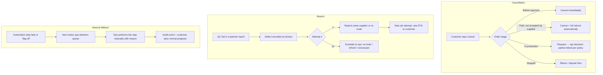

# UX Architecture

> Status: **Draft v0.1 — awaiting owner approval** · Phase 0B
> Related: [UI_DESIGN_SYSTEM](./UI_DESIGN_SYSTEM.md) · [MOTION_SYSTEM](./MOTION_SYSTEM.md) · [LOCALIZATION_GLOSSARY](./LOCALIZATION_GLOSSARY.md)

## 1. UX principles → concrete rules

| Principle | Rule we design and review against |
|---|---|
| Obvious | Every screen has **one** visually dominant primary action. The secondary actions are visibly secondary |
| Calm | No more than one blocking decision per step. No modal on top of a modal. Errors appear next to their cause |
| Intelligent | Prefill from what we already know (geometry, previous orders, locale, address book). Never ask what we can compute |
| Fast | Show results progressively (dimensions first, then the full analysis). Optimistic UI only where rollback is safe |
| Trustworthy | Real system state only. Every price shows its breakdown on demand. Every date shows whether it's an estimate or a commitment |
| Guided | A persistent "what happens next" panel in the customer order view and on the supplier job card |
| Predictable | The same component means the same thing everywhere (status chips, timelines, money) |
| Premium | Considered empty, loading and error states. Typography and motion are tuned, not defaulted |
| Progressive disclosure | Technical details (layer height, infill, walls, orientation) live behind "Technical details" and "Advanced mode". Default hidden |

**The "what do I do next?" test:** for every screen and state, the design must name the next action in one sentence of the target language. A screen with no next action (e.g. "waiting for supplier") must still say what is happening, who owns it, and when the user will hear back.

## 2. Personas

| ID | Persona | Context | Goals | Frustrations | Design implications |
|---|---|---|---|---|---|
| P1 | **Dana, 38, "fix it" consumer** (Hebrew, mobile) | A dishwasher rack clip snapped. Has no CAD, has a phone camera | Get a working replacement, cheaply and quickly, with no jargon | Being asked technical questions; uncertainty about whether it'll fit | Flow B with photo capture, a reference-scale guide (coin/ruler), plain-language questions, a human-review promise with an expected response time |
| P2 | **Alex, 29, maker** (English/Russian, desktop) | Has an STL from Printables/own CAD | Fast price, choose color, ship quickly | Opaque quotes, re-entering info | Flow A, instant quote, advanced mode available, saved addresses, quick reorder |
| P3 | **Yossi, 45, SMB maintenance lead** (Hebrew) | Replaces machine guards and brackets monthly | Repeatability, invoices with VAT, approval by the owner | Re-explaining every time, chasing invoices | Reorder from history, Phase 8: org library, POs, monthly billing |
| P4 | **Marina, 33, print-farm operator** (Russian, phone on the floor, gloves) | Runs 12 printers | Know what to print next, with which material, by when | Tiny buttons, unclear requirements, payment uncertainty | Large primary actions, a job card with the essentials above the fold, photo upload in two taps, offline-tolerant upload retry |
| P5 | **Avi, 50, supplier manager** | Owns the workshop | Fill capacity, get paid on time | Admin overhead | Capacity calendar, payout statements, simple machine/material editor |
| P6 | **Noa, ops admin** | Runs the marketplace day to day | See what's blocked/late/failing, fix it quickly | Context-switching between tools | An attention queue sorted by urgency, one-click overrides with a reason, keyboard shortcuts |
| P7 | **Igor, quality reviewer** | Reviews QC evidence | A fast, consistent pass/fail | Bad photos, missing measurements | A side-by-side compare (model vs photo), a checklist per material/use, a defect taxonomy |
| P8 | **Lior, CAD designer** | Produces models for Flow B/C | A clear brief, few revision loops | Ambiguous requirements | A structured brief, reference photos with measurements, a revision diff and comments |
| P9 | **Finance admin** | Money in and out | Reconcile, refund correctly, pay suppliers | Manual spreadsheets | A ledger view, reconciliation flags, approvals |
| P10 | **Support agent** | Answers customers | Answer status questions in seconds | Not knowing the real state | A customer 360 with order timeline, notifications sent and an internal notes thread |

## 3. Information architecture

### 3.1 Customer (mobile-first)
```
Home (value prop + 3 entry cards: I have a file / an object / an idea)
├── New order wizard  /{locale}/new/{flow}/{step}
├── Orders            list → order detail (timeline, what's next, documents, reorder)
├── Quotes            (inside order detail; standalone link from email)
├── Saved parts       (MVP: reorderable past items; Phase 7: Digital Parts)
├── Account           profile, addresses, language, notifications, privacy (export/delete)
└── Help              FAQ, policies, contact (support ticket)
```
### 3.2 Supplier (mobile-first, glove-friendly)
```
Today      (jobs due today, offers awaiting response — the default view)
Offers     accept / decline with reason
Jobs       list by status → job card (files, material, qty, deadline, payout, QC requirements, next action)
Capacity   machines, materials, availability, holidays
Payouts    statements, invoice upload
Profile    company, locations, team
```
### 3.3 Admin (desktop-first, dense)
```
Dashboard (attention queue + KPIs) · Orders · Quotes · Requests (Flow B/C) · Customers · Suppliers · Machines · Materials
Designs · Digital Parts · Production Jobs · QC · Payments · Payouts · Shipping · Disputes · Support
Pricing Rules · Routing Rules · AI Runs · System Events · Audit Log · Feature Flags · Settings
```
Global: command palette (⌘K) for "go to order MF-…", search by customer email, quick actions.

## 4. Customer order wizard

### 4.1 Structure (adapts per flow — a correction to the spec's fixed sequence)

| # | Step | Flow A (file) | Flow B (object) | Flow C (idea) |
|---|---|---|---|---|
| 1 | What do you need? | choose | choose | choose |
| 2 | Upload or describe | upload model(s) | photos (camera or library) + short description | free-text description + optional sketch/photos |
| 3 | Usage | indoor/outdoor, heat, load, flexibility, appearance, food contact, restricted-use check | same | same |
| 4 | Dimensions | **confirm** computed size + units (scale if needed) | key dimensions + reference object guide | approximate size + constraints ("must fit 35 mm hole") |
| 5 | Visual review | 3D viewer: original → analyzed (issues highlighted) | photo review with annotated dimensions | summary card of the interpreted requirements |
| 6 | Recommendation | material + process + quality, with a "why" for each | (after human review) | (after human review / design) |
| 7 | Price | instant quote with breakdown, quantity, color, urgency | "we'll send your quote within X business hours" | design fee quote → later production quote |
| 8 | Checkout | address, delivery option, payment (hosted page) | (when the quote arrives) | (when the design is approved) |

The quantity and urgency selectors sit on the **Price** step, where their effect on price is visible, and aren't collected as abstract form fields earlier.

### 4.2 Behaviour requirements
- **Save progress:** every step change persists the server-side `wizard_draft`. Guests get an anonymous draft token (cookie), claimed at sign-in. Resume link by email for signed-in users.
- **Recover after refresh:** the URL carries the step; the draft carries the data. Uploads in progress resume or restart with a clear message (S3 multipart for > 20 MB).
- **Progress:** a step indicator with labels on desktop; a compact "Step 3 of 7 · Usage" with a progress bar on mobile. Steps that are not applicable to the flow are omitted, not disabled.
- **Explain why:** each usage question has an info affordance: "We ask because hot cars reach 70 °C — some plastics soften."
- **Minimum fields:** no field without a downstream consumer (pricing, recommendation, routing, QC, shipping). Every field is reviewed against this in M1.
- **Mobile:** thumb-reachable primary action (sticky bottom bar), native camera capture for photos, large radio cards instead of selects, numeric keypad for measurements.

### 4.3 Usage questions → requirements (examples; the full rule table lives in `requirements` module)

| Question (plain) | Options | Drives |
|---|---|---|
| Where will it be used? | Indoors · Outdoors · In a car · In a bathroom/kitchen | UV/moisture resistance, max temp |
| Will it get hot? | No · Warm (≤ 50 °C) · Hot (≤ 80 °C) · Very hot (> 80 °C → review) | material min heat deflection |
| Does it carry weight or force? | No · Light · Moderate · Heavy (→ review) | material strength, walls/infill (internal) |
| Does it need to bend or flex? | Rigid · Slight flex · Rubber-like | TPU vs rigid |
| How important is appearance? | Functional · Clean · Showpiece | quality profile, post-processing |
| Will it touch food or drink? | No · Yes (→ review + certified only) | restricted-use policy |
| Which dimensions must be exact? | free text + mark on viewer | tolerance notes for QC |
| How many? | 1 … n | quantity breaks |
| How soon? | Standard · Fast · Urgent | urgency tier, routing SLA |

## 5. Journeys (summary maps)

### 5.1 Customer — Flow A (happy path, target ≤ 3 min to price)
Land → "I have a file" → drop STL → live analysis stages → confirm size → 3 usage questions → see recommendation + price → adjust qty/color → sign in (OTP) → address → pay → order timeline → notifications at each milestone → delivered → rate → reorder.

### 5.2 Customer — Flow B / C (concierge in the MVP)
Describe/photos → usage → dimensions → submit → "Request received" with an SLA ("we'll reply within 1 business day") → ops review (may ask clarification questions in the order thread) → quote (or a design fee quote) → pay → (design loop: revision preview → approve or request changes, max 2 included revisions) → production quote → pay difference / or included → same as Flow A from PAID.

### 5.3 Supplier
Invite email → onboarding checklist (company, location, machines, materials, payout details, agreement) → admin activation → **offer notification** (push/email/SMS later) → open offer card (payout, deadline, material, size, quantity) → accept within SLA → download production file → mark "printing" → upload QC photos + required measurements → mark "ready for pickup" → courier pickup → payout statement accrues → monthly statement → upload invoice → paid.

### 5.4 Admin / Ops
Dashboard attention queue → item (e.g. "Routing failed: no capacity for PA-CF") → context panel (order, candidates, explanations) → action (manual assign / change material with customer consent / hold) → reason → resolved → the queue updates. Daily: review REVIEW_REQUIRED requests, QC_PENDING items, late jobs, failed payments, webhook failures.

### 5.5 B2B (Phase 8)
Org admin invites colleagues → sets an approval limit → engineer creates an order from the org library → it exceeds the limit → manager approves in one click from email → PO number attached → monthly invoice.

## 6. Workflow analysis (the nine questions, per major workflow)

| Workflow | User wants | Info needed | Min steps | Automatable | Confusion risk | Failure modes | Recovery | Visible now | Hidden until needed |
|---|---|---|---|---|---|---|---|---|---|
| **File upload & analysis** | "Will this print, and what size is it?" | File, units | 1 (drop) + 1 (confirm units) | Validation, analysis, unit heuristic | Units (STL has none), long waits | Unsupported format, corrupt mesh, too large, timeout, non-manifold | Plain-language reason + fix tips; "continue anyway → manual review"; re-upload keeps the other answers | Stage-by-stage real progress, dimensions as soon as known | Triangle count, mesh repair details |
| **Usage questions** | Answer quickly | Environment, loads, look | 3–6 taps | Defaults from category/history | Jargon, "why do you ask?" | Contradictory answers (outdoor + food) | Inline note, review flag | Question + why | Mapping to material properties |
| **Recommendation** | Trust the choice | Requirements | 0 (shown) | Fully (rules) | "Why PETG not PLA?" | No material satisfies constraints | Offer review / relax constraint with explanation | Recommended option + 1-line reason, alternatives | Property tables, advanced overrides |
| **Quote & price** | A fair, final price | Qty, color, urgency | 1 | Fully (cost-plus) | Hidden fees, changing prices | Rule flag → manual review | "We're checking this one manually — reply by…" | Total incl. VAT + delivery, date range | Line breakdown (expand) |
| **Checkout & payment** | Pay safely | Address, method | 2 | Address autocomplete, saved cards (PSP token) | Leaving the site to a hosted page | Declined card, 3DS failure, webhook delay | Retry, alternative method; "payment processing" state with auto-refresh; never double-charge | Amount, what you're paying for | — |
| **Order tracking** | "Where is my part?" | — | 0 | Status from events | Internal jargon | Delays | Proactive delay notice with a new date + apology/compensation policy | Timeline, current stage, next step, ETA | Supplier identity, internal notes |
| **Design approval** | Approve or request changes | Revision preview | 1 | Notifications | Not understanding the 3D preview | Too many revisions | Included-revision counter, paid extra revision, call option | Preview, key dimensions, approve/change buttons | CAD files |
| **Supplier accept** | Decide fast | Payout, deadline, material, size, qty | 1 | Pre-filtering for compatibility | Missing details | Can't make the deadline | Decline with a reason → re-routing; propose a new date (Phase 3) | Payout, due date, material, qty | Customer identity (never shown) |
| **Supplier QC upload** | Prove the part is right | Photos, measurements | 2–3 | Checklist generated from requirements | Which measurements? | Bad photos | Photo guide overlay, retake prompt, offline queue | Checklist with progress | Model internals |
| **QC review** | Consistent verdict | Evidence vs spec | 1 | Phase 9: automated checks | Ambiguous evidence | Missing evidence | "Needs info" request to the supplier | Side-by-side, checklist, tolerance | History |
| **Cancellation** | Stop the order | Reason | 2 (confirm) | Before payment: instant | What's refundable? | Cancelling after production started | Clear policy per stage, shown *before* confirmation | Refund amount + timing | — |
| **Refund** | Money back | Reason, amount | Customer: request; Finance: 2 | Full refund pre-production | Partial refunds | PSP refund failure | Retry, manual bank transfer fallback, audit | Status + expected days | Ledger |
| **Reprint** | Get a correct part | Defect evidence | Customer: report (photos) | Routing of the reprint job | Who pays? | Repeat failure | Escalation to ops after the 2nd failure; offer a refund | New ETA | Root cause details (internal) |
| **Escalation** | A human to help | Context | 1 ("Get help") | Ticket with context attached | — | — | Response SLA shown | Ticket status | Internal notes |
| **Manual fallback** (any automation) | Business continues | Same as auto | Ops: 1 action + reason | — | — | Automation down/flag off | Every automated step has an ops action in the admin | "In review" state for the customer, with an SLA | — |

## 7. Cross-cutting UX states

### 7.1 Empty states (each has a title, one helpful sentence, and a primary action)
| Where | Message intent | Action |
|---|---|---|
| Customer — no orders | "Your parts will appear here" | Start an order |
| Supplier — no offers | "No offers right now — your availability is ON" | Check capacity settings |
| Admin — attention queue empty | "Nothing needs you right now" (+ last refresh time) | View today's orders |
| Search — no results | "No results for '…'" + suggestions | Clear filters |

### 7.2 Loading states
- Skeletons that mirror the final layout for content. Staged progress for long-running work (upload, analysis, payment confirmation), showing only real stages.
- > 10 s: explain what's happening. > 60 s: offer "we'll email you when it's ready".

### 7.3 Error states (taxonomy → presentation)
| Class | Example | Presentation |
|---|---|---|
| Field validation | "Height must be between 1 and 500 mm" | Inline under the field, plus a summary at the top for screen readers |
| Recoverable action | Payment declined | Inline banner at the action, the retry action focused |
| Blocked by policy | Restricted use | Explanation + alternative ("request manual review") |
| System / unknown | 500 | Friendly message, request id ("reference code") for support, retry; never a raw error |
| Offline | Supplier on the floor | Persistent banner, queued uploads with a retry indicator |

### 7.4 Onboarding
- Customer: none required. The first-order guidance is contextual. After the first order: "Save your address / enable notifications".
- Supplier: a checklist with progress (5 items), blocking activation until complete, with help per item.
- Staff: a role-based tour of the attention queue (dismissible).

## 8. Approval, cancellation, refund, reprint, escalation and manual-fallback flows (state diagrams)



Approval flows: design approval (customer), quote override (admin, reason), pricing rule activation (two-person), refund above threshold (finance second approval), B2B spend approval (Phase 8), supplier activation (admin).

## 9. Accessibility (UX level)
- Every flow is completable by keyboard and screen reader in all three languages (Hebrew screen-reader testing with NVDA + VoiceOver).
- The 3D viewer always has a non-visual equivalent: a dimensions table, an issues list and a static preview image with alt text.
- Time limits (offer SLA, quote expiry) are shown in text and never enforced in a way that interrupts the current input.
- Target WCAG 2.2 AA, plus an accessibility statement page as required in Israel.

## 10. UX validation plan
- M1–M2: moderated usability tests, 5 users per language (he/en/ru), Flow A on mobile. Task success, time to price, SUS.
- Supplier: 2 field sessions at real print farms before M3 sign-off.
- Admin: a "day in the life" walkthrough with ops before M4 sign-off.
- Findings are logged in `KNOWN_ISSUES.md` (UX section) with a severity.
