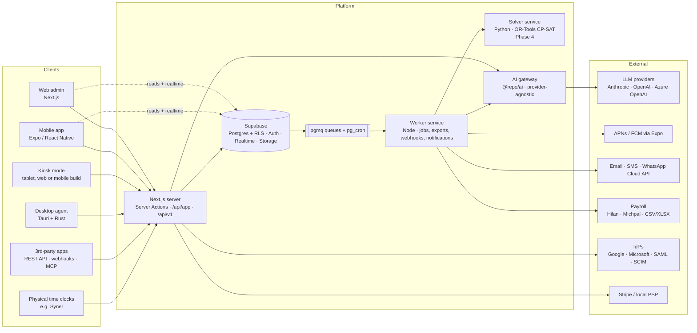

# 01 · Architecture

> Status: **Phase 0 draft, for review.** Working codename **Tempo**
> (a placeholder until a product name is chosen). Code uses the
> name-neutral package scope `@repo/*`, so a rename later touches
> branding only, not imports.

## 1. Guiding principles

1. **One event log, many views.** Every punch, break, activity sample
   and schedule change is an immutable, timestamped event. Timesheets,
   payroll exports, the unified timeline and dashboards are _derived_
   from those events. This keeps the record legally defensible (the
   employer has to prove hours worked) and makes AI previews, undo
   and audit cheap.
2. **The database enforces tenancy.** Every tenant row carries
   `org_id`, every table has RLS enabled, and foreign keys are
   _composite_ `(org_id, id)`, so a row cannot point at another
   tenant's row even if application code has a bug. RLS is the safety
   net. Business rules live in command handlers.
3. **Commands and reads are separate.** Reads (lists, detail views,
   realtime) go straight to Postgres through RLS from any client.
   Writes with invariants (clock-in, approve timesheet, publish
   schedule) go through a typed **command handler** in `@repo/core`,
   which runs inside a transaction _as the calling user_ (RLS still
   applies). That single path is where audit, webhooks, AI dry-runs
   and undo hook in.
4. **Offline is normal.** Deskless workers lose signal in basements,
   warehouses and on the road, and laptops sleep. Clients generate
   event IDs (UUIDv7) and device timestamps, queue events in a local
   outbox, and sync idempotently. The server records both
   `occurred_at` (device time) and `received_at` (server time) and
   flags skew.
5. **Privacy by default, not by settings page.** The desktop agent
   collects the least data that answers the question (aggregated
   minutes, not raw events; domains, not URLs; no window titles
   unless enabled), _only while clocked in_, with a visible indicator
   and a personal "what we collect about me" dashboard.
6. **Boring infrastructure, sharp product.** Postgres for
   everything it can do: queue (pgmq), cron (pg_cron), vectors
   (pgvector), full-text search, realtime. A new piece of
   infrastructure has to justify itself against "do it in Postgres".
7. **AI proposes, humans dispose.** Every AI action produces a
   reviewable _proposal_ (a diff of commands). Nothing destructive
   runs without explicit confirmation, and every applied proposal can
   be reverted.

## 2. System context



## 3. Technology decisions

The stack follows the brief. Departures and additions are marked
**(+)**, each with its reason.

| Concern                      | Choice                                                                                                                                                                                       | Why                                                                                                                                                                                                                                                |
| ---------------------------- | -------------------------------------------------------------------------------------------------------------------------------------------------------------------------------------------- | -------------------------------------------------------------------------------------------------------------------------------------------------------------------------------------------------------------------------------------------------- |
| Monorepo                     | pnpm workspaces + Turborepo                                                                                                                                                                  | Shared types, tokens, i18n and domain logic across web, mobile and desktop; remote caching in CI.                                                                                                                                                  |
| Web                          | Next.js 16 (App Router), TypeScript, Tailwind v4, shadcn/ui (Base UI primitives), Motion (Framer Motion)                                                                                     | As specified. The existing `wacrm` codebase already runs this exact stack, so we carry over proven patterns (see §13).                                                                                                                             |
| Mobile                       | Expo (React Native, latest SDK), Expo Router, Reanimated, expo-sqlite, expo-location, expo-local-authentication                                                                              | As specified. A dev-client build (not Expo Go) because geofencing, widgets and Live Activities need native modules.                                                                                                                                |
| Desktop agent                | Tauri 2 (Rust core)                                                                                                                                                                          | As specified. The **tray process is pure Rust**. The webview window opens only on demand and is destroyed when closed. That is how we hit < 50 MB idle; an open WebView2/WKWebView alone costs 80–150 MB.                                          |
| Database                     | Supabase Postgres 17 + RLS                                                                                                                                                                   | As specified. Extensions: `pgmq`, `pg_cron`, `pgvector`, `pg_trgm`, `btree_gist` (exclusion constraints for overlapping shifts), `postgis` (geofences).                                                                                            |
| Server data access **(+)**   | Kysely (typed SQL) over a pooled Postgres connection, wrapped in `withUserTx(jwt, fn)`, which runs `SET LOCAL role authenticated` and `request.jwt.claims`                                   | supabase-js can't run multi-statement transactions. Commands need atomicity (write entry + audit + outbox event together) _and_ RLS. Kysely is a query builder rather than an ORM, which keeps SQL migrations the source of truth.                 |
| Migrations                   | Plain SQL in `supabase/migrations`, types generated (`supabase gen types` + `kysely-codegen`)                                                                                                | Database-first: RLS, triggers and functions are SQL anyway.                                                                                                                                                                                        |
| Validation                   | Zod schemas in `@repo/contracts`, shared by every client and the server; OpenAPI 3.1 generated from them                                                                                     | One definition per payload, end to end.                                                                                                                                                                                                            |
| Background jobs **(+)**      | Supabase Queues (pgmq) + pg_cron, consumed by `apps/worker` (Node, long-running)                                                                                                             | Jobs are enqueued in the _same transaction_ as the domain write (transactional outbox), so an event is never lost and never half-published. Edge Functions are kept for short webhook-style tasks only, because of their time limits.              |
| Scheduling optimizer **(+)** | `services/solver`: Python + Google OR-Tools CP-SAT (Phase 4)                                                                                                                                 | LLMs are poor at constraint satisfaction. The LLM turns intent ("keep under budget, Dana prefers mornings") into constraints and explains the result; CP-SAT finds a feasible, optimal roster. This is the one non-TS service, and it is worth it. |
| Mobile offline               | Local SQLite outbox for writes (append-only events, idempotent by client UUID); TanStack Query with persisted cache for reads                                                                | Our offline _writes_ are append-only events, so a full sync engine isn't needed in Phase 1. PowerSync (Supabase-compatible) stays the escape hatch if offline editing of shared data becomes a requirement.                                        |
| Realtime                     | Supabase Realtime: private **Broadcast** channels authorized by RLS (chat, presence, live "who's on shift"); Postgres Changes only for low-volume admin views                                | Broadcast scales far better than Postgres Changes for chat fan-out.                                                                                                                                                                                |
| Search                       | Postgres FTS (`simple` config + `pg_trgm`) for names and messages; pgvector for knowledge base and AI retrieval                                                                              | Postgres has no Hebrew stemmer; trigram matching handles Hebrew prefixes and typos well.                                                                                                                                                           |
| i18n                         | ICU message catalogs in `@repo/i18n`; `next-intl` on web, `use-intl` on mobile and desktop UI                                                                                                | One catalog, one message syntax, three platforms.                                                                                                                                                                                                  |
| Auth                         | Supabase Auth: email+password, magic link, **phone OTP**, Google, Microsoft, SAML SSO, TOTP MFA. Device principals for kiosks and desktop agents. SCIM 2.0 implemented in our API (Phase 5). | Many deskless workers have no corporate email; phone login is mandatory for them.                                                                                                                                                                  |
| Files                        | Supabase Storage, path-scoped `org_id/...` with RLS; signed URLs; ClamAV scan in the worker; separate encrypted bucket for screenshots                                                       |                                                                                                                                                                                                                                                    |
| Notifications **(+)**        | Expo Push (APNs/FCM), email (Postmark or SES), SMS, and **WhatsApp Cloud API**                                                                                                               | WhatsApp is how Israeli frontline teams actually communicate. Shift reminders, swap approvals and announcement nudges over WhatsApp are a real edge over Connecteam, and the WhatsApp integration already exists in this repo.                     |
| AI                           | `@repo/ai`: provider adapters (Anthropic default, OpenAI, Azure OpenAI for in-region customers), prompt templates as versioned files, eval suites run in CI                                  | Provider-agnostic as specified.                                                                                                                                                                                                                    |
| Observability                | Sentry (web, mobile, desktop, worker), OpenTelemetry traces → Grafana Cloud / Honeycomb, structured JSON logs, Supabase log drains                                                           |                                                                                                                                                                                                                                                    |
| Product analytics **(+)**    | PostHog (EU cloud or self-hosted), events with no PII                                                                                                                                        | Needed to measure "operational in 10 minutes", activation and feature adoption.                                                                                                                                                                    |
| Hosting                      | Web on Vercel (fra1) or a container; Supabase in eu-central-1 (Frankfurt); worker and solver on Fly.io / AWS ECS in the same region                                                          | Latency from Israel to Frankfurt is about 50–60 ms. See open question Q2 on in-Israel residency (AWS il-central-1).                                                                                                                                |
| Payments                     | Stripe Billing, behind a `BillingProvider` interface so an Israeli PSP (e.g. Tranzila, Cardcom) can be added                                                                                 |                                                                                                                                                                                                                                                    |

## 4. Multi-tenancy model

```
partner (optional, white-label reseller)          Phase 5
└── organization  ← tenant boundary, RLS key = org_id
    ├── legal_entity     (payroll employer: company no., deductions file)
    ├── location         (branch: timezone, geofence, address)
    ├── department       (tree)
    ├── team             (optionally tied to a location/department)
    └── member           (a person in this org; may or may not have a login)
```

- **A user can belong to many organizations** (contractors, accountants,
  franchise managers). `wacrm` assumed one account per user; we do not.
  The active org is a client-side choice, and every query filters by
  `org_id`. RLS checks membership in _that_ org, so switching orgs needs
  no token refresh.
- **Members without logins.** Kiosk-only employees are first-class:
  `members.user_id` is nullable. They punch with a PIN or badge at a
  shared device and can be invited to the app later without losing
  history.
- **Composite foreign keys** everywhere:
  `FOREIGN KEY (org_id, member_id) REFERENCES members (org_id, id)`.
  Cross-tenant references are impossible at the schema level.
- **Isolation tests.** A pgTAP suite creates two orgs and asserts,
  table by table, that org A's users can neither read nor write org
  B's rows. CI fails if a new table ships without RLS enabled and a
  matching isolation test.

## 5. Authorization (RBAC + scopes)

- **Permission catalog** (static, in code and seeded to the DB): keys like
  `time.entries.read`, `time.entries.edit`, `time.timesheets.approve`,
  `schedule.shifts.publish`, `tracking.screenshots.view`,
  `people.pay_rates.read`, `org.billing.manage`.
- **Roles** are permission bundles. System roles (Owner, Admin, Manager,
  Employee, Contractor, Guest) are immutable templates. Custom roles are
  per org.
- **Role assignments carry a scope**: `org`, `location:<id>`,
  `department:<id>` (with descendants) or `team:<id>`. "Shift lead at
  Haifa" is the Manager role scoped to `location:haifa`.
- **Self-permissions** (`self.*`: my timesheet, my schedule, my tracking
  data) are implicit for every member.
- **Enforcement in RLS** goes through `STABLE SECURITY DEFINER` helpers:
  - `is_org_member(org_id)`
  - `has_org_perm(org_id, perm)` for org-wide settings tables
  - `can_access_member(org_id, target_member_id, perm)` for people-scoped
    data. This one is backed by a precomputed `member_visibility(viewer_member_id,
target_member_id, role_assignment_id)` table, refreshed by triggers
    when assignments or team/location memberships change. At 2,000
    employees the worst case is a few hundred thousand rows per org,
    which is trivially indexed and much faster than walking scope
    trees inside every policy.
  - Policies use `(select auth.uid())` so Postgres evaluates the call
    once per statement, not once per row.
- **Field-level sensitivity.** Pay rates, national ID, bank details and
  medical notes live in _separate tables_ with stricter policies. Row
  visibility never implies seeing salary.
- **Audit log.** Append-only, monthly-partitioned `audit_log` with a
  hash chain (`hash = sha256(prev_hash || row)`), so tampering is
  detectable. `INSERT` is granted only to a definer function;
  `UPDATE`/`DELETE` are granted to no one. Written by the command layer
  (with before/after diffs) and by triggers on sensitive tables as a
  backstop.

## 6. Command layer (writes)

```
client ──► Server Action / POST /api/app/commands/:name / POST /api/v1/...
             │  zod-validate input (@repo/contracts)
             ▼
        withUserTx(jwt) ──► command handler (@repo/core)
             │   1. authorize (permission + scope)
             │   2. load state, check invariants (pure functions, unit-tested)
             │   3. write domain rows
             │   4. write audit_log row(s)
             │   5. enqueue domain_event → pgmq   (same transaction)
             ▼
          COMMIT ──► worker: webhooks · notifications · recompute timesheet · AI hooks
```

- **Pure domain core.** Overtime calculation, break compliance, rest
  between shifts, rounding, conflict detection and accrual math are pure
  TypeScript functions in `@repo/core` with exhaustive tests. The same
  code runs on the server for truth and on the client for instant
  previews ("this shift puts Noa into 150% overtime").
- **Dry run.** Every command supports `dryRun: true`, which runs steps
  1–3 inside a transaction that is rolled back and returns the diff.
  This powers AI previews and the "what will change" confirmation
  dialogs.
- **Undo.** Commands that support it declare an inverse. Applied AI
  proposals store their command list, and revert = apply the inverses
  (time-limited, re-authorized).
- **Idempotency.** Commands accept an `idempotency_key`, required for
  mobile, desktop and the public API, and stored for 24 h.

## 7. Time & attendance core

- **`time_events`** is append-only: clock in/out, break start/end, job
  switch. It records source (mobile, web, kiosk, desktop, hardware,
  API), device, GPS position and accuracy, the geofence verdict,
  verification method (PIN, photo, face, none), device time, server
  time and flags.
- **`time_entries`** are the editable, payroll-relevant intervals,
  derived from events. A manager edit changes the _entry_, never the
  event, and requires a reason. It is audited and the employee is
  notified. Original evidence is always preserved.
- **Policies** (`attendance_policies`) are versioned JSON configurations,
  validated by zod, with presets. `il_standard` encodes Israeli
  hours-of-work defaults (42-hour week, overtime tiers 125%/150%,
  rest-day premium, night-shift rules, minimum rest between shifts). It
  is configurable per org and **must be validated by Israeli labor
  counsel before GA**; numbers are never hard-coded in logic.
- **Anomaly detection, rule-based first** (Phase 1): missed punch, open
  shift longer than N hours (auto clock-out with a flag),
  out-of-geofence, punch far from the schedule, insufficient rest,
  overtime cap. **Statistical** later (Phase 4): buddy-punch suspicion
  from device/IP/photo patterns, unusual hours.
- **Business date.** An entry's `work_date` is derived from its start in
  the _location's_ timezone (an overnight shift belongs to the day it
  started). Everything is stored as UTC `timestamptz` plus the IANA
  zone, so DST transitions are handled correctly.
- **Payroll export.** Each org maps our hour categories (regular, OT125,
  OT150, rest-day, night, paid break, sick, vacation, reserve duty…) to
  its payroll provider's pay codes (`pay_code_mappings`). Exporters for
  generic CSV/XLSX ship in Phase 1; Hilan and Michpal formats follow
  once we have their file specs (open question Q3). A locked period is
  immutable, and any later correction becomes an adjustment in the next
  period.

## 8. Desktop agent architecture (Phase 2, designed now)

```
┌──────────────────────── Tauri app (single binary, signed) ───────────────┐
│ Rust core (always running, tray only, target < 50 MB / < 1% CPU)         │
│  ├─ state machine: SignedOut → Enrolled → Off-clock ⇄ Tracking ⇄ Paused  │
│  │     tracking runs ONLY while server says member is clocked in         │
│  ├─ samplers (OS adapters)                                               │
│  │     idle:   Win GetLastInputInfo · mac CGEventSource · Linux X11/IdleMon│
│  │     focus:  Win GetForegroundWindow · mac NSWorkspace (+AX if allowed)│
│  │     url:    browser extension (domain only), never history scraping   │
│  │     input intensity: event *counts* per minute, never key contents    │
│  ├─ aggregator → 1-minute buckets (app, domain, category, active/idle s) │
│  ├─ encrypted local store (SQLite + SQLCipher, key in OS keychain)       │
│  ├─ sync: batched upload every 60 s, exponential backoff, idempotent     │
│  ├─ screenshots (if policy): capture → local blur → notify employee      │
│  │     → upload after grace window unless the employee deletes it        │
│  ├─ integrity: heartbeat, clock-skew check, permission-revoked and       │
│  │     process-kill detection → device_integrity_events (never blocking) │
│  └─ updater: Tauri updater, signature-verified, staged rollout channels  │
│ WebView UI (created on demand, destroyed on close):                      │
│     timer · project picker · idle prompt · "what we collect" panel       │
└──────────────────────────────────────────────────────────────────────────┘
```

- **Enrollment.** The employee signs in through the system browser
  (OAuth PKCE with a loopback redirect), _or_ MDM pre-provisions an
  org enrollment token (Intune via MSI properties, Jamf via a
  configuration profile). The device receives a scoped refresh token
  stored in the OS keychain and bound to `devices.id`.
- **Distribution.** MSI (WiX) and MSIX for Windows, notarized `.pkg`
  for macOS, AppImage/deb for Linux. Silent install flags are
  documented. On macOS, Screen Recording and Accessibility permissions
  are requested with clear explanations and pre-approved via PPPC
  profiles under MDM.
- **No stealth mode, ever.** The tray icon is always visible and shows
  state (tracking, paused, off). The agent cannot run without a visible
  indicator; this is enforced in code, not by a setting.
- **Data minimization defaults.** Window titles **off**, URLs
  **domain-only**, screenshots **off**, input intensity **off**. Each
  one can be enabled only with an org policy _and_ a published
  monitoring notice that the employee has acknowledged.
- **Volume estimate.** 1,000 tracked users × 8 h × 60 min × ~1.5 app
  segments ≈ 720k bucket rows a day. `activity_buckets` is partitioned
  monthly and rolled up into `activity_daily` after 30 days. Raw
  partitions are dropped per the retention policy, so purge is
  `DROP PARTITION` rather than slow deletes.

## 9. AI layer

- **`@repo/ai` gateway**: `complete()`, `structured<T>(zodSchema)`,
  `embed()`, tool calling, and streaming. Adapters for Anthropic
  (default: the latest Claude models), OpenAI and Azure OpenAI.
  Per-org settings cover provider, region, opt-out per module, and an
  optional bring-your-own key (encrypted).
- **Tools = commands.** The assistant's tools are the same command
  handlers the UI uses, invoked with `dryRun: true`. The assistant
  can therefore never do more than the user could, and every action
  is previewable.
- **Proposal → review → apply → revert.** Stored in `ai_proposals` with
  the command list, the dry-run diff, the model, the prompt version and
  token usage.
- **Grounding.** Natural-language analytics ("why was overtime up 18% in
  Haifa?") translate to _parameterized, whitelisted_ metric queries
  over a semantic layer, never free-form SQL. Answers cite the numbers
  they used.
- **Privacy.** PII is minimized before prompts (IDs instead of names
  where possible), nothing is used for provider training (enterprise
  terms), prompts and outputs are logged with retention, and the
  desktop-activity module is excluded from AI by default.
- **Evals.** Each prompt template has a golden set (Hebrew and English)
  in `packages/ai/evals`, scored in CI. A prompt change that regresses
  the score fails the build.

## 10. Security

| Area                                                                                 | Control                                                                                                                                                                                                                                                                 |
| ------------------------------------------------------------------------------------ | ----------------------------------------------------------------------------------------------------------------------------------------------------------------------------------------------------------------------------------------------------------------------- |
| Tenant isolation                                                                     | RLS on every table, composite FKs, pgTAP isolation suite in CI                                                                                                                                                                                                          |
| Transport / rest                                                                     | TLS 1.2+ everywhere, HSTS; Supabase disk encryption (AES-256); **app-level envelope encryption** (AES-256-GCM, KMS-held KEK) for national ID, bank details, medical notes and integration secrets                                                                       |
| Secrets                                                                              | Supabase Vault / cloud secret manager; nothing in repo; `gitleaks` in CI                                                                                                                                                                                                |
| AuthN                                                                                | MFA (TOTP) enforceable per org/role; SSO enforcement; session revocation; device tokens revocable; kiosk PINs hashed (argon2id), rate-limited, with lockout                                                                                                             |
| Rate limiting                                                                        | Edge WAF + per-key/per-user token buckets (Postgres- or Redis-backed); stricter limits on auth, PIN and OTP endpoints                                                                                                                                                   |
| OWASP Top 10                                                                         | zod validation at every boundary; parameterized SQL only; CSP with nonces; SSRF guard on outbound webhooks (ported from `wacrm`); signed, expiring storage URLs; dependency scanning (Renovate, `npm audit`, cargo-audit); SAST (CodeQL)                                |
| Webhooks                                                                             | HMAC-SHA256 signatures with timestamps (replay protection), retries with backoff for 24 h, delivery log, endpoint auto-disable on persistent failure                                                                                                                    |
| Audit                                                                                | Hash-chained, append-only `audit_log`; exportable; employees can see who accessed their tracking data                                                                                                                                                                   |
| Israeli Privacy Protection Law (incl. Amendment 13) & Data Security Regulations 2017 | Database registration/notification assessment, a data-security procedure document, an access-permissions matrix, periodic access reviews, incident response runbook, DPO designation support. Biometrics and monitoring data are treated as data of special sensitivity |
| GDPR                                                                                 | DPA, RoPA, a DPIA template for monitoring, data-subject export/delete tooling, EU hosting, sub-processor list                                                                                                                                                           |
| Backups / DR                                                                         | Supabase PITR; nightly encrypted logical dumps to a separate cloud account; quarterly restore drill; RPO ≤ 5 min, RTO ≤ 4 h                                                                                                                                             |

## 11. Quality and delivery

- **Tests**
  - Unit: Vitest (`@repo/core` targets ≥ 95% branch coverage; overtime and
    accrual math is property-tested with fast-check).
  - DB: pgTAP for RLS isolation, permission scopes, triggers.
  - Integration: command handlers against a real local Supabase
    (`supabase start` in CI).
  - E2E web: Playwright, Hebrew-RTL and English-LTR projects, light and
    dark mode, axe accessibility checks on every page.
  - E2E mobile: Maestro flows (sign in, clock in offline then sync,
    claim open shift, chat).
  - Desktop: Rust unit tests for aggregation and the state machine;
    integration test with a mock OS adapter; soak test for the memory budget.
  - Critical-flow gates: clock-in, schedule publish, payroll export and
    tracking sync must pass before any release.
- **CI/CD** (GitHub Actions + Turborepo cache): lint, typecheck, test,
  build per affected package. Supabase preview branches per PR; EAS
  Build + EAS Update channels for mobile; Tauri build matrix (win/mac/
  linux) with code signing and notarization; staged rollout channels
  (internal → beta → stable) for desktop and mobile.
- **Environments**: local (Supabase CLI) → preview (per PR) → staging →
  production. Production migrations are applied by CI only.
- **Performance budgets** (enforced in CI where measurable): web LCP < 2 s
  on simulated 4G (Lighthouse CI), INP < 100 ms, route JS < 170 kB gz;
  mobile cold start < 2 s on a mid-range Android device (measured with a
  Maestro + `adb` script); desktop agent < 50 MB RSS and < 1% CPU idle
  (soak test).

## 12. Architecture Decision Records (summary)

| #       | Decision                                                                           | Status                       |
| ------- | ---------------------------------------------------------------------------------- | ---------------------------- |
| ADR-001 | Monorepo with pnpm + Turborepo; shared `@repo/*` packages                          | Proposed                     |
| ADR-002 | Supabase Postgres as system of record; RLS + composite FKs for tenancy             | Proposed                     |
| ADR-003 | Command/read split; commands in `@repo/core` executed via `withUserTx` with Kysely | Proposed                     |
| ADR-004 | Append-only `time_events` + derived editable `time_entries`                        | Proposed                     |
| ADR-005 | Jobs via pgmq + pg_cron + Node worker (transactional outbox)                       | Proposed                     |
| ADR-006 | Desktop agent: Rust tray core, on-demand webview, aggregate-only telemetry         | Proposed                     |
| ADR-007 | Scheduling optimizer: OR-Tools CP-SAT service; LLM for intent and explanation only | Proposed (Phase 4)           |
| ADR-008 | AI actions = dry-run commands → proposals → explicit apply → revertible            | Proposed                     |
| ADR-009 | Single ICU catalog (`@repo/i18n`), Hebrew-first, logical CSS properties only       | Proposed                     |
| ADR-010 | New repository, harvesting patterns from `wacrm` rather than forking it            | **Needs your decision (Q1)** |

Full ADRs will live in `docs/adr/NNN-*.md` once Phase 0 is approved.

## 13. What we reuse from `wacrm`

This repo is a WhatsApp CRM, not a workforce product, so a fork would
drag along an unrelated domain (contacts, deals, broadcasts). It does
contain battle-tested pieces worth porting:

| `wacrm` piece                                                                                | Reused as                                                |
| -------------------------------------------------------------------------------------------- | -------------------------------------------------------- |
| `is_account_member()` RLS pattern (migration 017)                                            | Basis for `is_org_member` / `has_org_perm`               |
| API keys: hashed, prefixed, scoped (`src/lib/api-keys`, migration 026)                       | Public API keys                                          |
| Webhook signing, delivery and SSRF guard (`src/lib/webhooks`)                                | Outbound webhooks                                        |
| AI provider adapters, encrypted BYO keys, usage metering, knowledge retrieval (`src/lib/ai`) | `@repo/ai` foundation                                    |
| MCP server (`mcp-server/`)                                                                   | "Drive your workforce from Claude" integration (Phase 5) |
| WhatsApp Cloud API client (`src/lib/whatsapp`)                                               | WhatsApp notification channel                            |
| Rate limiter, presence heartbeat, theme switcher, next-intl setup                            | Direct ports                                             |
