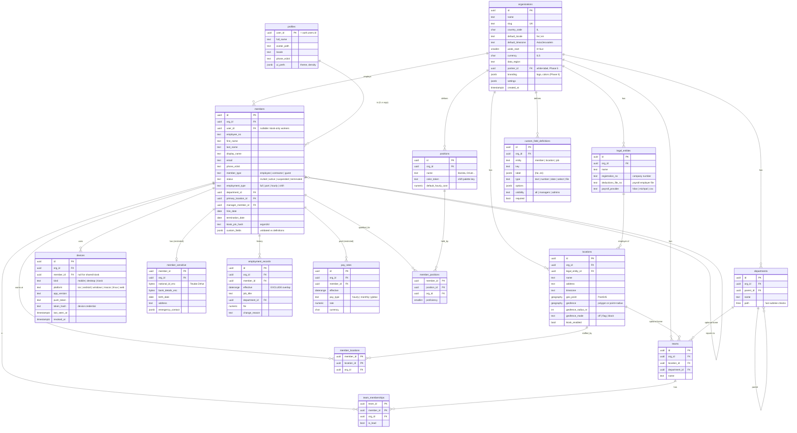
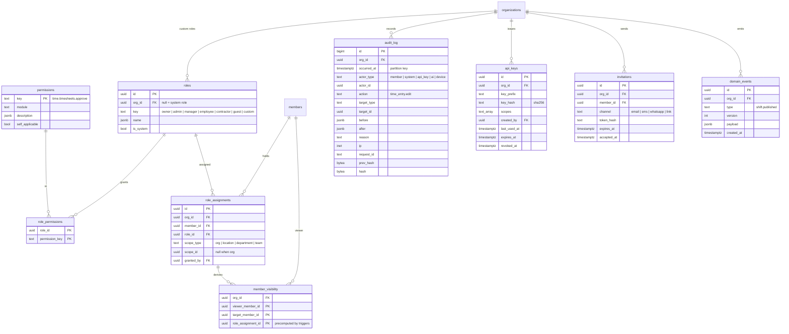
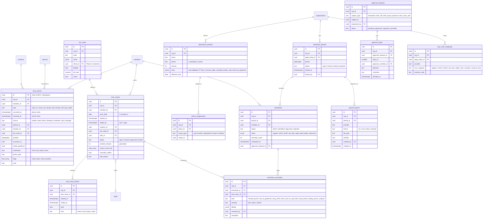
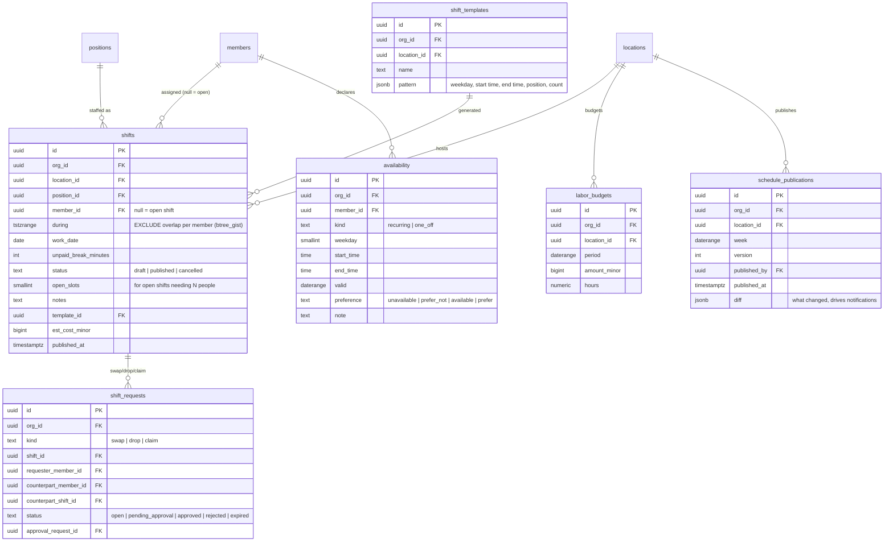
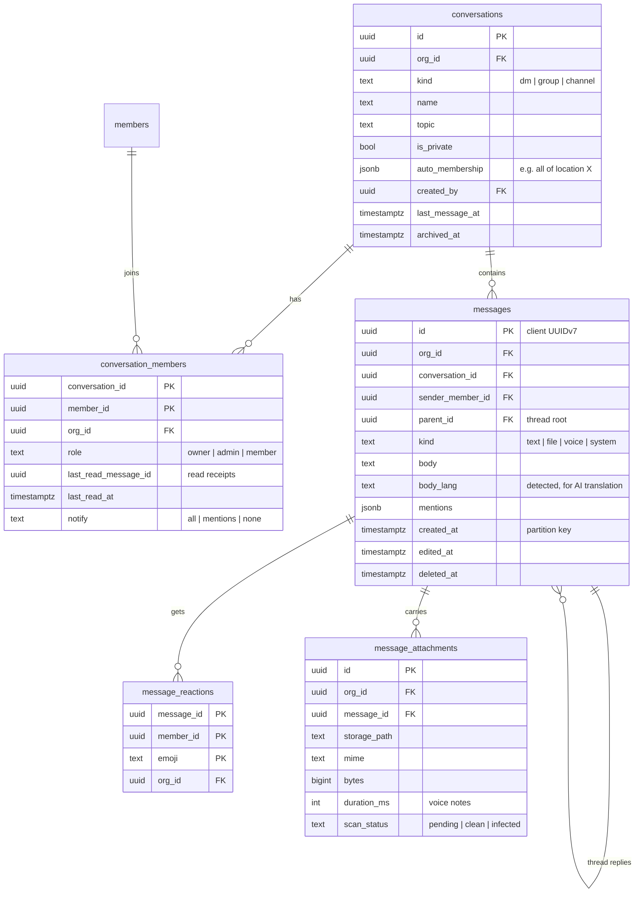

# 02 · Data model (ERD)

> Phase 1 and 2 tables are specified column by column. Phase 3–5 tables
> are outlined (name, purpose, key relations) and get full detail in
> their phase plan.

## Conventions (apply to every table)

| Rule             | Detail                                                                                                                                                                          |
| ---------------- | ------------------------------------------------------------------------------------------------------------------------------------------------------------------------------- |
| Primary keys     | `uuid`, **UUIDv7** (time-ordered, good index locality). Generated client-side for offline-created rows (`time_events`, `messages`), server-side otherwise.                      |
| Tenancy          | Every tenant table has `org_id uuid NOT NULL`, RLS enabled, and indexes that lead with `org_id`.                                                                                |
| Composite FKs    | `UNIQUE (org_id, id)` on parent tables. Children reference `(org_id, parent_id)`, so cross-tenant links are impossible.                                                         |
| Time             | `timestamptz` (UTC) everywhere. Wall-clock concepts (shift templates, availability) use `time` + the location's IANA zone. `work_date date` is computed in the location's zone. |
| Money            | `bigint` minor units + `currency char(3)`. Rates are `numeric(12,4)`.                                                                                                           |
| Audit columns    | `created_at`, `updated_at` (trigger), `created_by` (member id) where meaningful.                                                                                                |
| Deletes          | Hard delete + audit row by default. `deleted_at` soft delete only where retention law needs it (time records, documents).                                                       |
| Balances         | Never a mutable number. Always a **ledger** (time-off accruals, recognition points) with a derived balance view.                                                                |
| Enums            | Postgres enums only for closed, stable sets (`member_status`). Open-ended sets use `text` + `CHECK`, or lookup tables.                                                          |
| Sensitive fields | Separate tables with stricter RLS; app-level encrypted (`bytea`, `_enc` suffix).                                                                                                |
| Large tables     | `time_events`, `activity_buckets`, `messages`, `audit_log` are range-partitioned by month.                                                                                      |

---

## A. Tenancy, identity & org structure (Phase 1)



## B. Access control, audit & API (Phase 1)



## C. Time & attendance (Phase 1)



`approval_requests` is a **generic approval engine**. Timesheets, time-off,
shift swaps, expenses and retro edits all reuse it, with
multi-step chains defined per org.

## D. Scheduling (Phase 1 basic; Phase 4 AI)



## E. Chat (Phase 1)



Read receipts use `conversation_members.last_read_message_id` (one row per
member per conversation), not per-message receipts. Per-message
read-confirmation tracking is reserved for mandatory-read announcements
(Phase 3).

## F. Computer activity tracking (Phase 2)

```mermaid
erDiagram
  organizations ||--o{ tracking_policies : defines
  tracking_policies ||--o{ tracking_policy_assignments : "applies to"
  organizations ||--o{ monitoring_notices : publishes
  monitoring_notices ||--o{ notice_acknowledgements : "acknowledged by"
  members ||--o{ notice_acknowledgements : signs
  members ||--o{ activity_buckets : generates
  devices ||--o{ activity_buckets : "sampled on"
  app_catalog ||--o{ activity_buckets : identifies
  organizations ||--o{ category_rules : configures
  members ||--o{ idle_periods : resolves
  members ||--o{ screenshots : "captured for"
  devices ||--o{ device_integrity_events : reports
  members ||--o{ activity_daily : "rolled up"

  tracking_policies {
    uuid id PK
    uuid org_id FK
    text name
    bool enabled
    int idle_threshold_s "default 300"
    bool idle_prompt
    bool track_apps
    bool track_window_titles "default false"
    text track_urls "off | domain"
    bool track_input_intensity "default false"
    int screenshot_interval_min "null = off"
    bool screenshot_blur
    int employee_delete_grace_min
    jsonb retention_days "per data class"
    uuid notice_id FK "must be acknowledged before activation"
  }
  tracking_policy_assignments {
    uuid id PK
    uuid org_id FK
    uuid policy_id FK
    text scope_type
    uuid scope_id
  }
  monitoring_notices {
    uuid id PK
    uuid org_id FK
    int version
    jsonb body "{he, en} plain-language notice"
    jsonb data_collected "machine-readable list"
    timestamptz effective_at
  }
  notice_acknowledgements {
    uuid id PK
    uuid org_id FK
    uuid notice_id FK
    uuid member_id FK
    uuid device_id FK
    timestamptz acknowledged_at
    inet ip
  }
  app_catalog {
    uuid id PK
    text platform
    text identifier "bundle id or exe name"
    text display_name
    text default_category
  }
  category_rules {
    uuid id PK
    uuid org_id FK
    text scope_type "org | team | position"
    uuid scope_id
    text match_type "app | domain"
    text match_value
    text category "productive | neutral | unproductive"
  }
  activity_buckets {
    uuid id PK
    uuid org_id FK
    uuid member_id FK
    uuid device_id FK
    timestamptz bucket_start "1-minute, partition key"
    smallint active_s
    smallint idle_s
    uuid app_id FK
    text domain
    text window_title "only if policy allows"
    text category
    smallint input_intensity "counts bucketed 0-4, never content"
    uuid time_entry_id FK
    uuid job_code_id FK
  }
  activity_daily {
    uuid org_id FK
    uuid member_id PK
    date day PK
    int active_s
    int idle_s
    int focus_s "uninterrupted >= 25 min"
    int context_switches
    int meeting_s
    jsonb by_category
    jsonb top_apps
  }
  idle_periods {
    uuid id PK
    uuid org_id FK
    uuid member_id FK
    tstzrange during
    text resolution "offline_work | meeting | break | personal_excluded | discard"
    uuid job_code_id FK
    text note
  }
  screenshots {
    uuid id PK
    uuid org_id FK
    uuid member_id FK
    uuid device_id FK
    timestamptz captured_at
    smallint display_index
    text storage_path "encrypted bucket"
    bool blurred
    text status "grace | visible | deleted_by_employee | purged"
    timestamptz grace_until
  }
  device_integrity_events {
    uuid id PK
    uuid org_id FK
    uuid device_id FK
    text kind "agent_stopped | clock_tamper | permission_revoked | heartbeat_gap | uninstall"
    jsonb details
    timestamptz occurred_at
  }
```



**Unified timeline (read model).** `member_day_timeline` is a view (later a
table refreshed by the worker) that merges, per member per day:
scheduled `shifts`, `time_entries` and breaks from any source,
`activity_buckets` collapsed into contiguous segments, `idle_periods`,
and tasks/jobs (Phase 3). Every segment carries a `source` so the UI can
show _how_ each minute is known.

**Employee transparency.** Every manager read of screenshots or activity
detail writes an `audit_log` row. The employee's privacy dashboard shows
"who viewed my data, when".

## G. Later phases (outline)

| Phase                      | Tables                                                                                                                                                                                                                                         | Notes                                                                                             |
| -------------------------- | ---------------------------------------------------------------------------------------------------------------------------------------------------------------------------------------------------------------------------------------------- | ------------------------------------------------------------------------------------------------- |
| 3 · Tasks & jobs           | `task_lists`, `tasks`, `task_assignees`, `task_checklist_items`, `task_attachments`, `recurrence_rules`, `customers`, `sites` (geo), `jobs`, `job_visits`, `job_status_history`                                                                | Tasks use `recurrence_rules` (RRULE). Jobs link to `job_codes` for billing and to `time_entries`. |
| 3 · Forms                  | `forms`, `form_versions` (immutable JSON schema), `form_submissions`, `submission_files`, `form_workflows`, `escalations`                                                                                                                      | Submissions are pinned to a version; scoring and conditional logic live in the schema.            |
| 3 · Time off               | `time_off_types` (incl. sick, vacation, **reserve duty / מילואים**, bereavement), `time_off_policies` (accrual rules), `time_off_ledger` (accrual, usage, adjustment, carry-over), `time_off_requests` → `approval_requests`                   | Balance = `SUM(ledger)`; negative-balance limits enforced in the command.                         |
| 3 · Documents & onboarding | `document_types` (with expiry), `documents`, `document_requests`, `signatures` (evidence: hash, IP, timestamp), `onboarding_flows`, `onboarding_steps`, `onboarding_runs`                                                                      |                                                                                                   |
| 3 · Announcements          | `announcements`, `announcement_targets` (scope rules), `announcement_reads` (mandatory-read confirmations), `surveys`, `survey_questions`, `survey_responses` (anonymous mode stores no `member_id`), `events`, `event_rsvps`                  |                                                                                                   |
| 4 · AI                     | `ai_threads`, `ai_messages`, `ai_proposals` (commands, dry-run diff, status, applied_at, reverted_at), `ai_usage`, `ai_settings`                                                                                                               |                                                                                                   |
| 4 · Analytics              | `metric_definitions` (semantic layer), `reports`, `report_schedules`, `report_runs`                                                                                                                                                            |                                                                                                   |
| 4 · Learning & KB          | `kb_spaces`, `kb_articles`, `kb_chunks` (pgvector), `courses`, `course_versions`, `lessons`, `quizzes`, `enrollments`, `certifications` (expiry), `member_skills`                                                                              | `member_skills` also feeds the scheduler's skill constraints.                                     |
| 3–4 · HR extras            | `expenses`, `expense_receipts` (OCR fields), `recognitions`, `points_ledger`, `rewards`, `redemptions`, `tickets`, `ticket_messages`, `reviews`, `one_on_one_notes`                                                                            |                                                                                                   |
| 5 · Platform               | `partners`, `custom_domains`, `subscriptions`, `invoices`, `usage_snapshots` (seat counts), `integrations`, `integration_secrets` (Vault), `webhook_endpoints`, `webhook_deliveries`, `scim_tokens`, `sso_connections`, `calendar_connections` |                                                                                                   |

## H. Key RLS policies (sketch)

```sql
-- Org-wide settings tables (locations, positions, policies…)
create policy read  on locations for select using (is_org_member(org_id));
create policy write on locations for all
  using (has_org_perm(org_id, 'org.locations.manage'))
  with check (has_org_perm(org_id, 'org.locations.manage'));

-- People-scoped data (time_entries, shifts, timesheets…)
create policy read on time_entries for select using (
  member_id = any (my_member_ids())                         -- self
  or can_access_member(org_id, member_id, 'time.entries.read')
);

-- Append-only evidence: no UPDATE/DELETE policy exists at all.
create policy insert_own on time_events for insert with check (
  member_id = any (my_member_ids())
  or can_access_member(org_id, member_id, 'time.entries.edit')  -- manager punch
);
```

Every policy has a matching pgTAP test (`supabase/tests/rls/*.sql`).
